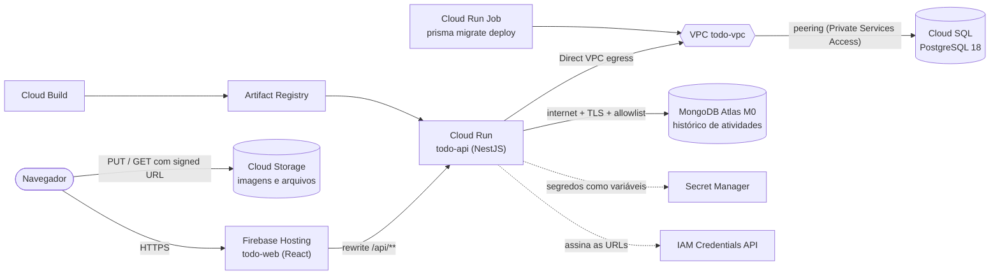

# Hospedando uma aplicação real no Google Cloud

Material da aula de **Computação em Nuvem**. Ao longo dos capítulos os alunos publicam, no GCP, um app de tarefas (**Todo Cloud**) com usuários e senha, projetos, imagens e arquivos anexos e compartilhamento anônimo de projetos por link.

> O app é só o veículo. O objetivo é praticar **hospedagem**: containers, serverless, redes privadas, bancos gerenciados, armazenamento de objetos, segredos e CDN.

## O que será construído

| Peça | Serviço no GCP | Capítulo |
|---|---|---|
| Front-end React (arquivos estáticos + CDN) | Firebase Hosting | [10](todo-aula/10-firebase-hosting.md) |
| API NestJS em container | Cloud Run (serviço) | [09](todo-aula/09-cloud-run.md) |
| Migrations do Prisma | Cloud Run (job) | [09](todo-aula/09-cloud-run.md) |
| PostgreSQL 18 | Cloud SQL, IP privado | [04](todo-aula/04-cloud-sql-postgresql.md) |
| MongoDB 8 (não muda de banco) | MongoDB Atlas (M0 gratuito) em GCP | [05](todo-aula/05-mongodb-atlas.md) |
| Imagens e arquivos | Cloud Storage + signed URLs | [06](todo-aula/06-cloud-storage.md) |
| Senhas e chaves | Secret Manager | [07](todo-aula/07-secret-manager.md) |
| Imagens Docker | Artifact Registry + Cloud Build | [08](todo-aula/08-artifact-registry-e-cloud-build.md) |
| Rede privada | VPC, Private Services Access (peering), Direct VPC egress; comparação com Private Service Connect | [03](todo-aula/03-rede-vpc-e-conexao-privada.md) |

## Estrutura do repositório

| Pasta | Conteúdo |
|---|---|
| `todo-api/` | API NestJS 12 + Prisma 7 + Mongoose 9 (código, Dockerfile, `cloudbuild.yaml`, `docker-compose.yml`) |
| `todo-web/` | Front-end React 19 + Vite 8 (código e `firebase.json`) |
| [`todo-aula/`](todo-aula/) | Os capítulos da aula (abaixo) e o script de teste de ponta a ponta |

## Menu

| # | Arquivo | Conteúdo |
|---|---|---|
| 1 | [01-arquivos-de-configuracao.md](todo-aula/01-arquivos-de-configuracao.md) | Cria os arquivos de configuração dos dois projetos (Dockerfile, docker-compose, cloudbuild, firebase.json...) e testa tudo **localmente** |
| 2 | [02-projeto-gcp-e-ferramentas.md](todo-aula/02-projeto-gcp-e-ferramentas.md) | Conta, projeto, faturamento, alerta de orçamento, gcloud e APIs |
| 3 | [03-rede-vpc-e-conexao-privada.md](todo-aula/03-rede-vpc-e-conexao-privada.md) | VPC, peering com o Cloud SQL, PSC × peering e Cloud NAT opcional |
| 4 | [04-cloud-sql-postgresql.md](todo-aula/04-cloud-sql-postgresql.md) | Instância PostgreSQL 18 com IP privado, banco e usuário |
| 5 | [05-mongodb-atlas.md](todo-aula/05-mongodb-atlas.md) | Cluster M0 em GCP, usuário, acesso de rede (e o alerta de segurança do `0.0.0.0/0`) |
| 6 | [06-cloud-storage.md](todo-aula/06-cloud-storage.md) | Bucket, CORS, permissões e signed URLs |
| 7 | [07-secret-manager.md](todo-aula/07-secret-manager.md) | Segredos e conta de serviço da API |
| 8 | [08-artifact-registry-e-cloud-build.md](todo-aula/08-artifact-registry-e-cloud-build.md) | Repositório Docker e build das imagens na nuvem |
| 9 | [09-cloud-run.md](todo-aula/09-cloud-run.md) | Job de migrations e serviço da API |
| 10 | [10-firebase-hosting.md](todo-aula/10-firebase-hosting.md) | Publicação do React e rewrite para o Cloud Run |
| 11 | [11-validacao-custos-e-limpeza.md](todo-aula/11-validacao-custos-e-limpeza.md) | Testes de ponta a ponta, custo total, como apagar tudo e problemas comuns |

Cada capítulo de recurso termina com uma **estimativa mensal de custo** baseada nas páginas oficiais de preço. Há também o script de teste de ponta a ponta [`scripts/smoke-test.sh`](todo-aula/scripts/smoke-test.sh), usado no capítulo 11.

## Decisões de projeto (e por quê)

| Decisão | Motivo |
|---|---|
| **Região `us-central1` (Iowa)** | Preço Tier 1 no Cloud Run; uma das 3 regiões elegíveis à cota gratuita do Cloud Storage (`us-central1`, `us-east1` e `us-west1`); recomendada pelo Firebase para ficar junto do Hosting. São Paulo (`southamerica-east1`) funciona, mas é Tier 2 (mais cara) e o Storage não tem cota gratuita lá |
| **Cloud Run** em vez de VM | Escala a zero, paga por uso e cabe na cota gratuita |
| **Cloud SQL `db-f1-micro`, IP privado** | Menor instância disponível (US$ 0,0105/h); sem IP público, o banco não fica exposto |
| **MongoDB Atlas M0** | O Mongo **não muda**; o Atlas gratuito roda em GCP. Limite: 512 MB e sem rede privada (peering/PSC exigem M10+) |
| **Prisma 7.10 (Postgres) + Mongoose 9 (Mongo)** | O `latest` do CLI do Prisma é a RC `8.0.0-rc.15`; a linha 7 é a estável. Um schema do Prisma tem um único datasource, então cada banco tem seu cliente |
| **Upload direto ao Cloud Storage (signed URL)** | O Cloud Run limita o corpo da requisição; enviar direto ao bucket poupa CPU e dinheiro |
| **Firebase Hosting com rewrite `/api/**`** | Front e API na mesma origem: sem CORS, sem cookies entre domínios |

## Versões usadas (verificadas em 20/09/2026)

| Ferramenta | Versão |
|---|---|
| Node.js | 24 (LTS) |
| NestJS | 12.0.3 |
| Prisma (CLI e client) | 7.10.0 (estável) |
| Mongoose | 9.10.1 |
| @google-cloud/storage | 8.2.0 |
| Front-end: React / Vite / TypeScript | 19.3.0 / 8.3.0 / 7.0.2 |
| API: TypeScript (do Nest CLI 12) | 6.0.3 |
| PostgreSQL / MongoDB (local e nuvem) | 18 / 8.0 |
| gcloud CLI | 581.0.0 |
| Firebase CLI | 15.30.2 |

## Como ler os capítulos

- **Terminal** e **Console** são dois caminhos para o mesmo resultado. Faça um pelo terminal e confira pelo Console.
- Os comandos usam **Bash** (Cloud Shell, Git Bash, macOS ou Linux). No PowerShell, use o Cloud Shell.
- Os nomes ficam em variáveis definidas no [capítulo 2](todo-aula/02-projeto-gcp-e-ferramentas.md). Em terminal novo, rode `source ~/todo-aula.env`.
- Os valores das tabelas ("Nome", "Versão", "Região") são os que os comandos usam. Se mudar um, mude nos dois lugares.
- Preços em **USD**, consultados em 20/09/2026 nas páginas oficiais; considere 730 horas por mês.

## Pré-requisitos

| Item | Detalhe |
|---|---|
| Conta Google | Contas institucionais podem ter políticas de organização que bloqueiam recursos (veja [problemas comuns](todo-aula/11-validacao-custos-e-limpeza.md#4-problemas-comuns-visão-geral)). Prefira uma conta pessoal |
| Faturamento | Cartão de crédito. Novas contas ganham créditos de teste |
| Conta no MongoDB Atlas | Gratuita, sem cartão |
| Máquina do aluno | Node 24, Git e um terminal Bash. Docker só é necessário para testar localmente (capítulo 1) |

## Segurança: regras da turma

1. **Nunca** versione arquivos de credenciais (`.env`, `atlas-credentials.env`). Se uma senha aparecer em chat, e-mail ou repositório, troque-a.
2. Segredos vão para o **Secret Manager**, não para variáveis em texto puro nem para o código.
3. O acesso `0.0.0.0/0` do Atlas usado nas aulas é **um laboratório descartável**, com dados fictícios e prazo de expiração. Em projeto real não passa em revisão ([capítulo 5](todo-aula/05-mongodb-atlas.md)).

## Sobre a validação deste material

- O código (`todo-api` e `todo-web`) foi executado: testes unitários e e2e da API contra PostgreSQL 18 e MongoDB 8 reais, imagem de produção construída e iniciada em container e o front testado em navegador (cadastro, upload de imagem, link anônimo).
- Os comandos `gcloud` e `firebase` foram conferidos contra o `--help` das CLIs mais recentes e contra a documentação oficial. Como o material é a base da aula, **faça um ensaio completo em um projeto descartável antes de aplicar com a turma**.
