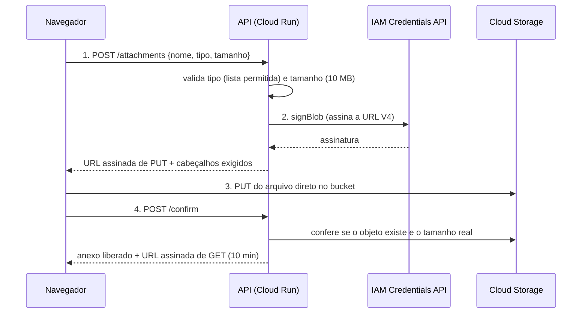

# 6. Cloud Storage: imagens e arquivos com signed URLs

As imagens e os arquivos anexados às tarefas **não** ficam no banco nem no disco do Cloud Run (que é efêmero e some a cada deploy). Eles vão para o **Cloud Storage**, o armazenamento de objetos do Google. O navegador envia e baixa os arquivos **direto do bucket**, com URLs temporárias assinadas pela API.

[← MongoDB Atlas](05-mongodb-atlas.md) · [README](../README.md) · [Próximo: Secret Manager →](07-secret-manager.md)

## Conceitos

| Termo | Explicação |
|---|---|
| **Bucket** | Contêiner de objetos. O nome é **único no mundo** |
| **Objeto** | O arquivo (mais metadados). Não há pastas de verdade: `projects/ID/tasks/ID/arquivo.png` é só um nome com barras |
| **Classe de armazenamento** | Standard = acesso frequente (a que usamos). Nearline/Coldline/Archive = mais baratas para dados raramente lidos |
| **Localização** | Região única (`us-central1`), dual-region ou multi-region |
| **Uniform bucket-level access (UBLA)** | Só o IAM decide o acesso, sem ACLs por objeto. É o modelo recomendado |
| **Public access prevention** | Trava que **impede** tornar o bucket ou seus objetos públicos, por engano |
| **Signed URL (V4)** | URL com assinatura e validade que permite **uma ação** (ler ou gravar) em **um objeto**, sem que o usuário tenha conta Google |
| **CORS** | Regra do navegador: para o site `web.app` fazer `PUT` no domínio `storage.googleapis.com`, o bucket precisa autorizar |
| **Soft delete** | Por padrão os objetos apagados ficam retidos por **7 dias** (e **são cobrados**) |

## O fluxo de upload (por que é assim)



| Decisão | Motivo |
|---|---|
| O arquivo **não passa pela API** | O Cloud Run limita o corpo de requisição a **32 MiB**, e transmitir arquivos gasta CPU (e dinheiro) da API |
| A API **assina** a URL com a *service account* do Cloud Run | Sem arquivo de chave JSON: a assinatura é feita pela **IAM Credentials API** (`signBlob`) |
| A URL de `PUT` já leva o **`Content-Type`** e o cabeçalho **`x-goog-content-length-range: 0,10485760`** assinados | O bucket **rejeita** (400) qualquer envio com tipo diferente ou acima de 10 MB |
| Validade curta (10 min, `SIGNED_URL_TTL_SECONDS=600`) | Uma URL vazada expira sozinha |
| Passo de **confirmação** | O anexo só aparece na tela depois que a API **confere** o objeto no bucket |
| Bucket **privado** | Ninguém acessa arquivos sem uma URL assinada |

## O que vamos criar

| Configuração | Valor | Observação |
|---|---|---|
| Nome do bucket | `<PROJECT_ID>-todo-files` | `$BUCKET`. Único no mundo |
| Localização | **Região única `us-central1`** | Uma das 3 regiões elegíveis à **cota gratuita** (`us-central1`, `us-east1`, `us-west1`) |
| Classe padrão | **Standard** | |
| Controle de acesso | **Uniform bucket-level access** ligado | |
| Prevenção de acesso público | **Ativada** (enforced) | |
| Soft delete | **Desativado** (`0`) | Só para o laboratório: evita cobrança de objetos apagados. Em produção mantenha |
| Versionamento | Desativado | |
| CORS | `PUT`, `GET`, `HEAD` das origens do Firebase Hosting e `localhost:5173` | Arquivo `todo-api/infra/gcs-cors.json` |

## Passo 1 — Criar o bucket

**Terminal**

```bash
source ~/todo-aula.env

gcloud storage buckets create "gs://$BUCKET" \
  --project="$PROJECT_ID" \
  --location="$REGION" \
  --default-storage-class=STANDARD \
  --uniform-bucket-level-access \
  --public-access-prevention \
  --soft-delete-duration=0

gcloud storage buckets describe "gs://$BUCKET" \
  --format="yaml(location,default_storage_class,uniform_bucket_level_access,public_access_prevention,soft_delete_policy)"
```

**Console**

1. **☰ → Cloud Storage → Buckets → Criar**.
2. **Nomeie seu bucket:** `<PROJECT_ID>-todo-files` → **Continuar**.
3. **Escolha onde armazenar os dados:** *Tipo de local* **Região** → `us-central1 (Iowa)` → **Continuar**.
4. **Escolha uma classe de armazenamento:** *Definir uma classe padrão* → **Standard** → **Continuar**.
5. **Escolha como controlar o acesso aos objetos:** marque **Aplicar a prevenção de acesso público neste bucket** e deixe **Uniforme** selecionado → **Continuar**.
6. **Escolha como proteger os dados de objeto:** desmarque **Política de exclusão reversível (soft delete)** (apenas no laboratório) → **Criar**.

## Passo 2 — Configurar o CORS

O arquivo `todo-api/infra/gcs-cors.json` traz `SEU-PROJETO` como marcador. Geramos uma cópia com o seu `PROJECT_ID`:

```bash
cd todo-api
sed "s/SEU-PROJETO/$PROJECT_ID/g" infra/gcs-cors.json > /tmp/gcs-cors.json
cat /tmp/gcs-cors.json

gcloud storage buckets update "gs://$BUCKET" --cors-file=/tmp/gcs-cors.json
gcloud storage buckets describe "gs://$BUCKET" --format="yaml(cors_config)"
```

**Console**

1. Abra o bucket → aba **Configuração** → seção **Compartilhamento de recursos entre origens (CORS)** → ícone de lápis (**Editar configuração de CORS**).
2. Marque **Permitir compartilhamento de recursos entre origens** → **Adicionar uma configuração**.
3. **Origens permitidas:** `https://<PROJECT_ID>.web.app`, `https://<PROJECT_ID>.firebaseapp.com` e `http://localhost:5173`.
4. **Métodos:** `PUT`, `GET`, `HEAD`. **Cabeçalhos de resposta permitidos:** `Content-Type` e `x-goog-content-length-range`. **Tempo de expiração do cache:** `3600`.
5. **Concluído → Salvar**.

> **Sintoma clássico de CORS mal configurado:** o navegador mostra `blocked by CORS policy` no `PUT`, mas o `curl` funciona. CORS é uma regra **do navegador**, não do servidor.

## Passo 3 — Permissões (feitas no capítulo 7)

O bucket é privado; quem grava, lê e apaga é a **conta de serviço da API**. Ela ainda não existe; no [capítulo 7](07-secret-manager.md) criamos a conta e concedemos:

| Permissão | Onde | Para quê |
|---|---|---|
| `roles/storage.objectUser` | No **bucket** | Criar, ler e apagar objetos (e consultar metadados) |
| `roles/iam.serviceAccountTokenCreator` | Na **própria conta de serviço** | Permite chamar `signBlob` para assinar as URLs |

> A API do IAM Credentials (`iamcredentials.googleapis.com`) já foi ativada no capítulo 2.

## Verificação

```bash
# Enviar e ler um arquivo com a SUA conta (papel de proprietario do projeto)
echo "ola nuvem" > /tmp/teste.txt
gcloud storage cp /tmp/teste.txt "gs://$BUCKET/teste/teste.txt"
gcloud storage ls "gs://$BUCKET/teste/"
gcloud storage rm "gs://$BUCKET/teste/teste.txt"

# O bucket deve recusar acesso anonimo (esperado: 401/403)
curl -s -o /dev/null -w "%{http_code}\n" "https://storage.googleapis.com/$BUCKET/teste/teste.txt"
```

| Verificação | Esperado |
|---|---|
| `describe` | `us-central1`, `STANDARD`, UBLA `True`, prevenção de acesso público `enforced` |
| `gcloud storage cp/ls/rm` | Funciona com a sua conta |
| Acesso anônimo por `curl` | **Negado** (o bucket é privado) |

## Problemas comuns

| Sintoma | Causa provável | Solução |
|---|---|---|
| `The specified bucket is not valid` / nome já usado | Nome global já existe | Inclua o `PROJECT_ID` (já é o padrão) |
| `SignatureDoesNotMatch` no `PUT` | O cabeçalho ou o `Content-Type` do `PUT` não é o que foi assinado | O front envia exatamente os `headers` devolvidos pela API |
| `EntityTooLarge` / `400` com `x-goog-content-length-range` | Arquivo maior que 10 MB | Limite intencional (`MAX_UPLOAD_BYTES`) |
| `403` na URL de download | URL expirou (10 min) | Recarregue a página para gerar outra |
| `Permission 'iam.serviceAccounts.signBlob' denied` | Falta `serviceAccountTokenCreator` na conta de serviço | Refaça o capítulo 7, passo 3 |
| `blocked by CORS policy` | CORS ausente ou origem errada | Refaça o passo 2 (confira as origens) |

## Custos deste capítulo

Fonte: [Cloud Storage pricing](https://cloud.google.com/storage/pricing), `us-central1`, consultada em 20/09/2026.

| Item | Preço oficial | Cota gratuita (Always Free) | Estimativa mensal (este roteiro: ~50 MB, ~500 operações) |
|---|---|---|---|
| Armazenamento Standard | US$ 0,000027397/GiB-h (≈ US$ 0,02/GiB-mês) | 5 GB-mês (`us-central1`, `us-east1`, `us-west1`) | US$ 0,00 |
| Operações Classe A (gravar, listar) | US$ 0,005 por 1.000 | 5.000 por mês | US$ 0,00 |
| Operações Classe B (ler, `exists`, metadados) | US$ 0,0004 por 1.000 | 50.000 por mês | US$ 0,00 |
| Saída de rede (download pelo navegador) | Tarifa de internet (Premium) | 100 GB/mês da América do Norte | US$ 0,00 |
| Signed URLs | Sem item de cobrança no Cloud Storage; a IAM Credentials API não cobra por chamada (sujeita a cotas de uso) | — | US$ 0,00 |
| **Total** | | | **US$ 0,00** |

Referência para crescer:

| Cenário | Cálculo | Custo mensal |
|---|---|---|
| 20 GB guardados | (20 − 5) × US$ 0,02 | US$ 0,30 |
| 10.000 uploads no mês | (10.000 − 5.000) ÷ 1.000 × US$ 0,005 | US$ 0,025 |
| Mesmo bucket em **São Paulo** (`southamerica-east1`) | Sem cota gratuita (a Always Free vale só em 3 regiões dos EUA) | Consulte a tabela de São Paulo na página de preços |

---

[← MongoDB Atlas](05-mongodb-atlas.md) · [README](../README.md) · [Próximo: Secret Manager →](07-secret-manager.md)
