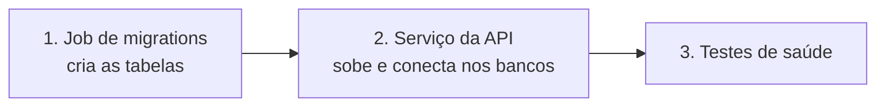

# 9. Cloud Run: o job de migrations e o serviço da API

O **Cloud Run** executa containers sem que você gerencie servidores: ele cria instâncias sob demanda, **escala a zero** quando não há tráfego e cobra por uso. Aqui juntamos tudo o que foi preparado: imagem (cap. 8), segredos e conta de serviço (cap. 7), rede privada e banco (caps. 3 e 4), Atlas (cap. 5) e bucket (cap. 6).

[← Artifact Registry e Cloud Build](08-artifact-registry-e-cloud-build.md) · [README](../README.md) · [Próximo: Firebase Hosting →](10-firebase-hosting.md)

## Conceitos

| Termo | Explicação |
|---|---|
| **Serviço (service)** | Container que responde a requisições HTTP. Tem uma URL `https://...run.app` |
| **Job** | Container que **executa e termina** (migrations, cargas, relatórios). Não recebe requisições |
| **Revisão** | Cada deploy cria uma revisão **imutável** (imagem + configuração). Permite *rollback* e divisão de tráfego |
| **Instância** | Uma cópia rodando da revisão. O Cloud Run cria e destrói conforme a demanda |
| **Concorrência** | Quantas requisições uma instância atende ao mesmo tempo (padrão 80) |
| **Cobrança por requisição** (padrão) | Você paga CPU e memória **só enquanto há requisição** sendo processada (mais a subida da instância). Sem tráfego, custo zero |
| **Instâncias mínimas** | `0` = escala a zero (barato, mas há *cold start*). `1` = sempre uma quente (cobrança ociosa) |
| **Startup probe** | Teste que o Cloud Run faz até o container ficar pronto |
| **Invoker IAM check** | Verificação de quem pode chamar o serviço. Serviço **público** = verificação desligada |

## Ordem obrigatória do deploy



A API assume que as tabelas existem. Migrar **antes** do deploy evita que várias instâncias tentem alterar o banco ao mesmo tempo.

## O que vamos criar

### Job de migrations

| Configuração | Valor |
|---|---|
| Nome | `todo-api-migrate` (`$JOB`) |
| Imagem | `$REGISTRY/todo-api-migrate:1.0.0` (comando padrão da imagem: `npx prisma migrate deploy`) |
| Região | `us-central1` |
| Conta de serviço | `todo-api-sa` |
| Segredo | `DATABASE_URL` ← `todo-database-url:1` |
| Rede | VPC `todo-vpc`, sub-rede `todo-subnet-run`, egress `private-ranges-only` |
| Recursos | 1 vCPU, 512 MiB, 1 tarefa, 1 nova tentativa, timeout de 300 s |

### Serviço da API

| Configuração | Valor | Observação |
|---|---|---|
| Nome | `todo-api` (`$SERVICE`) | **O mesmo nome vai no `firebase.json`** |
| Imagem | `$REGISTRY/todo-api:1.0.0` | |
| Região | `us-central1` | Também no `firebase.json` |
| Conta de serviço | `todo-api-sa` | Menor privilégio |
| CPU / memória | 1 vCPU / 512 MiB | |
| Instâncias | mínimo **0**, máximo **2** | Com `DB_POOL_MAX=3`, no máximo 6 conexões no `db-f1-micro` |
| Concorrência | 40 | |
| Timeout | 60 s | O Firebase Hosting também corta em 60 s |
| Porta | 8080 | O Cloud Run injeta `PORT=8080` |
| CPU boost | Ligado | Mais CPU na subida: reduz o *cold start* |
| Acesso | **Público** (`--no-invoker-iam-check`) | A própria API autentica com JWT |
| Entrada (ingress) | `all` | O Firebase Hosting precisa alcançar o serviço |
| Rede | VPC `todo-vpc`, sub-rede `todo-subnet-run`, egress `private-ranges-only` | Cloud SQL pela VPC; Atlas pela internet |
| Variáveis (não secretas) | `NODE_ENV=production`, `STORAGE_DRIVER=gcs`, `GCS_BUCKET`, `MONGODB_DB=todo`, `DB_POOL_MAX=3`, `TRUST_PROXY_HOPS=1`, `CORS_ORIGINS` | Arquivo `env.yaml` (abaixo) |
| Segredos (versão fixa) | `DATABASE_URL` ← `todo-database-url:1`; `MONGODB_URI` ← `todo-mongodb-uri:1`; `JWT_SECRET` ← `todo-jwt-secret:1` | Secret Manager |
| Startup probe | HTTP `GET /api/health`, a cada 5 s, até 30 falhas (150 s) | Folga para o atraso da VPC na subida |

> **Por que `--no-invoker-iam-check`?** É a forma **recomendada** pela documentação atual do Cloud Run para tornar um serviço público e funciona mesmo quando a organização usa a restrição de compartilhamento por domínio (que bloqueia o papel `allUsers`).

> **Por que `private-ranges-only`?** Só o tráfego para IPs privados (o Cloud SQL) passa pela VPC. O Atlas continua saindo pela internet normalmente. É o caminho que **não** exige Cloud NAT (e portanto não gera custo de rede).

## Passo 0 — Conferir a permissão de rede do Cloud Run

O agente de serviço do Cloud Run precisa usar sua sub-rede. Por padrão ele já tem `roles/run.serviceAgent`. Se o deploy reclamar de permissão de rede, conceda:

```bash
export PROJECT_NUMBER="$(gcloud projects describe "$PROJECT_ID" --format='value(projectNumber)')"
gcloud projects add-iam-policy-binding "$PROJECT_ID" \
  --member="serviceAccount:service-${PROJECT_NUMBER}@serverless-robot-prod.iam.gserviceaccount.com" \
  --role="roles/compute.networkUser" --condition=None
```

## Passo 1 — Criar e executar o Job de migrations

**Terminal**

```bash
source ~/todo-aula.env

gcloud run jobs create "$JOB" \
  --image="$REGISTRY/todo-api-migrate:$TAG" \
  --region="$REGION" \
  --service-account="$SA_EMAIL" \
  --set-secrets="DATABASE_URL=todo-database-url:1" \
  --network="$VPC" --subnet="$SUBNET" --vpc-egress=private-ranges-only \
  --cpu=1 --memory=512Mi \
  --tasks=1 --max-retries=1 --task-timeout=300s \
  --project="$PROJECT_ID"

gcloud run jobs execute "$JOB" --region="$REGION" --wait --project="$PROJECT_ID"
```

O `--wait` bloqueia até terminar. Veja o resultado:

```bash
gcloud run jobs executions list --job="$JOB" --region="$REGION"
```

O log deve conter `1 migration found in prisma/migrations` e `All migrations have been successfully applied.` (ou `Applying migration 20260920..._init`).

**Console**

1. **☰ → Cloud Run → Jobs → Criar job**.
2. **URL da imagem de contêiner:** clique em **Selecionar** → *Artifact Registry* → `todo` → `todo-api-migrate` → tag `1.0.0`.
3. **Nome do job:** `todo-api-migrate`. **Região:** `us-central1`. **Número de tarefas:** `1`. **Tentativas máximas:** `1`.
4. Abra **Contêineres, volumes, conexões, segurança**:
   - Aba **Contêiner** → **Variáveis e secrets → Referenciar um secret**: nome `DATABASE_URL`, secret `todo-database-url`, versão `1`. **Capacidade:** 1 CPU, 512 MiB, timeout `300`.
   - Aba **Conexões** → **Conectar a uma VPC para tráfego de saída** → **Enviar tráfego diretamente para uma VPC**: rede `todo-vpc`, sub-rede `todo-subnet-run`, roteamento *Rotear apenas solicitações para IPs particulares para a VPC*.
   - Aba **Segurança** → **Conta de serviço:** `todo-api-sa`.
5. **Criar** e depois **Executar**. Acompanhe em **Execuções → Registros**.

## Passo 2 — Implantar o serviço da API

Primeiro o arquivo de variáveis **não secretas** (o `--set-env-vars` não aceita vírgulas nos valores, por isso usamos um arquivo):

```bash
cat > /tmp/todo-api-env.yaml <<EOF
NODE_ENV: "production"
STORAGE_DRIVER: "gcs"
GCS_BUCKET: "$BUCKET"
MONGODB_DB: "todo"
DB_POOL_MAX: "3"
TRUST_PROXY_HOPS: "1"
CORS_ORIGINS: "https://$PROJECT_ID.web.app,https://$PROJECT_ID.firebaseapp.com"
EOF
```

**Terminal**

```bash
gcloud run deploy "$SERVICE" \
  --image="$REGISTRY/todo-api:$TAG" \
  --region="$REGION" \
  --service-account="$SA_EMAIL" \
  --port=8080 --cpu=1 --memory=512Mi --concurrency=40 --timeout=60 \
  --min-instances=0 --max-instances=2 --cpu-boost \
  --ingress=all --no-invoker-iam-check \
  --network="$VPC" --subnet="$SUBNET" --vpc-egress=private-ranges-only \
  --env-vars-file=/tmp/todo-api-env.yaml \
  --set-secrets="DATABASE_URL=todo-database-url:1,MONGODB_URI=todo-mongodb-uri:1,JWT_SECRET=todo-jwt-secret:1" \
  --startup-probe=httpGet.path=/api/health,httpGet.port=8080,periodSeconds=5,timeoutSeconds=3,failureThreshold=30 \
  --project="$PROJECT_ID"
```

| Flag | Por quê |
|---|---|
| `--service-account` | Executa como a conta de menor privilégio, não como a padrão do Compute Engine |
| `--min-instances=0 --max-instances=2` | Custo zero ocioso e teto de conexões no banco pequeno |
| `--concurrency=40` `--timeout=60` | Ajustes conscientes ao banco pequeno e ao limite do Firebase Hosting |
| `--no-invoker-iam-check` | Serviço público (a API se protege com JWT) |
| `--network/--subnet/--vpc-egress` | Direct VPC egress (capítulo 3) |
| `--set-secrets ...:1` | Segredos como variáveis, com **versão fixa** |
| `--startup-probe` | Só recebe tráfego quando `/api/health` responde; como a API só começa a escutar depois de conectar nos dois bancos, o teste passar significa que **Postgres e Mongo estão acessíveis** |

**Console**

1. **☰ → Cloud Run → Serviços → Implantar contêiner → Serviço**.
2. **Implantar uma revisão a partir de uma imagem existente** → selecione `todo-api` `1.0.0` no Artifact Registry.
3. **Nome do serviço:** `todo-api`. **Região:** `us-central1`.
4. **Autenticação:** *Permitir acesso público*. **Faturamento:** *Baseado em solicitação*.
5. **Escalonamento do serviço:** instâncias mínimas `0`, máximas `2`. **Entrada:** *Todas*.
6. Abra **Contêineres, volumes, rede, segurança**:
   - **Contêiner → Configurações:** porta `8080`, memória `512 MiB`, CPU `1`, **Aumento de CPU de inicialização** marcado, tempo limite `60`, simultaneidade máxima `40`.
   - **Contêiner → Variáveis e secrets:** adicione as variáveis do arquivo `env.yaml` e as 3 referências a secrets como variáveis (`DATABASE_URL`, `MONGODB_URI`, `JWT_SECRET`, versão `1`).
   - **Contêiner → Verificações de integridade → Adicionar verificação → Inicialização:** HTTP, caminho `/api/health`, porta `8080`, período `5`, tolerância a falhas `30`, tempo limite `3`.
   - **Rede:** *Conectar a uma VPC para tráfego de saída* → *Enviar tráfego diretamente para uma VPC* → rede `todo-vpc`, sub-rede `todo-subnet-run`, *Rotear apenas solicitações para IPs particulares*.
   - **Segurança → Conta de serviço:** `todo-api-sa`.
7. **Criar**. Aguarde a revisão ficar verde.

## Passo 3 — Verificar

```bash
export API_URL="$(gcloud run services describe "$SERVICE" --region="$REGION" --format='value(status.url)')"
echo "$API_URL"

curl -s "$API_URL/api/health"          # {"status":"ok"}
curl -s "$API_URL/api/health/ready"    # {"status":"ok","postgres":"up","mongo":"up"}

gcloud run services describe "$SERVICE" --region="$REGION" \
  --format="yaml(spec.template.spec.serviceAccountName,spec.template.metadata.annotations)"
```

| Verificação | Esperado |
|---|---|
| `/api/health/ready` | `postgres: up` e `mongo: up` (é a prova de que a rede privada, os segredos e o Atlas funcionam) |
| `/api/docs` | **404**: o Swagger fica desligado em produção |
| Anotações da revisão | Bloco *VPC access* com `todo-vpc`, `todo-subnet-run` e `private-ranges-only` |

Cadastre um usuário direto na URL do Cloud Run para conferir a API inteira:

```bash
curl -s -X POST "$API_URL/api/auth/register" -H 'Content-Type: application/json' \
  -d '{"name":"Aluno","email":"aluno@example.com","password":"senha-forte-123"}'
```

> Nesta etapa o **upload de arquivos** ainda não pode ser testado no navegador (o CORS/hosting vem no próximo capítulo). O teste completo está no [capítulo 11](11-validacao-custos-e-limpeza.md).

## Logs, versões e rollback

```bash
gcloud run services logs read "$SERVICE" --region="$REGION" --limit=50     # logs do container
gcloud run revisions list --service="$SERVICE" --region="$REGION"          # revisões
# Voltar para uma revisão anterior:
gcloud run services update-traffic "$SERVICE" --region="$REGION" --to-revisions=REVISAO=100
```

No Console: **Cloud Run → todo-api → Registros** (logs), **Revisões** (histórico e divisão de tráfego) e **Métricas**.

Para publicar uma versão nova: gere `1.0.1` no [capítulo 8](08-artifact-registry-e-cloud-build.md), execute o **job** de novo (se houver migration) e rode `gcloud run deploy "$SERVICE" --image="$REGISTRY/todo-api:1.0.1" --region="$REGION"` (as demais configurações são mantidas).

## Endurecimento opcional: IP fixo para o Atlas

Depois de criar o Cloud NAT ([capítulo 3](03-rede-vpc-e-conexao-privada.md#endurecimento-opcional-cloud-nat-com-ip-fixo)) e cadastrar o IP no Atlas:

```bash
gcloud run services update "$SERVICE" --region="$REGION" --vpc-egress=all-traffic
```

Agora **todo** o tráfego de saída sai pelo IP do NAT. Lembre-se: com Cloud NAT a documentação alerta para **atrasos de 30 s ou mais** na subida da instância (o startup probe de 150 s cobre isso).

## Problemas comuns

| Sintoma | Causa provável | Solução |
|---|---|---|
| `The user-provided container failed to start and listen on the port defined by PORT` | A API caiu na subida (variável inválida, banco inacessível) | `gcloud run services logs read` mostra o erro real. A API valida as variáveis e falha cedo |
| `Permission denied on secret ...` | Falta `secretAccessor` | Capítulo 7, passo 4.1 |
| Log com `MongoServerSelectionError` | IP fora da *IP Access List* do Atlas | Capítulo 5, passo 3 |
| `connection timeout` para o Postgres | Rede/egress não configurados, peering inativo ou IP errado no `todo-database-url` | Confira `gcloud run services describe` (bloco *VPC access*) e o segredo |
| `403 Forbidden` na URL `run.app` | Invoker IAM check ativo | `gcloud run services update "$SERVICE" --no-invoker-iam-check` |
| Primeira requisição lenta (segundos) | *Cold start* (escala a zero) | Normal. Para eliminar: `--min-instances=1` (custo ocioso, abaixo) |
| Job falha com `P1001 Can't reach database server` | Sub-rede/egress do **job** | Confirme `--network/--subnet` no job |
| Job falha com `permission denied for schema public` | Usuário sem permissão de criar objetos | Capítulo 4, tabela de problemas (`GRANT ALL ON SCHEMA public`) |
| Erro de falta de endereços IP na sub-rede ao escalar | Sub-rede pequena demais (cada serviço reserva IPs em blocos de 16) | Use `/24` (mínimo `/26`) |

## Custos deste capítulo

Fonte: [Cloud Run pricing](https://cloud.google.com/run/pricing), `us-central1` (Tier 1), consultada em 20/09/2026. A cota gratuita é **por conta de faturamento** e reinicia todo mês.

| Recurso | Preço oficial (cobrança por requisição) | Cota gratuita mensal |
|---|---|---|
| CPU | US$ 0,000024 por vCPU-segundo | 180.000 vCPU-s |
| Memória | US$ 0,0000025 por GiB-segundo | 360.000 GiB-s |
| Requisições | US$ 0,40 por milhão | 2 milhões |
| Job (cobrança por instância) — CPU | US$ 0,000018 por vCPU-s | 240.000 vCPU-s |
| Job — memória | US$ 0,000002 por GiB-s | 450.000 GiB-s |
| Saída de dados para a internet | Tarifa de rede Premium | 1 GiB/mês (América do Norte) |

| Cenário | Cálculo | Estimativa mensal |
|---|---|---|
| **Este roteiro**: 2.000 requisições de 300 ms (1 vCPU, 0,5 GiB) | 600 vCPU-s; 300 GiB-s; 2.000 requisições — tudo dentro da cota | **US$ 0,00** |
| **Uso leve**: 300.000 requisições de 200 ms | 60.000 vCPU-s; 30.000 GiB-s; 0,3 M requisições — tudo dentro da cota | **US$ 0,00** |
| Ponto em que a cota de CPU acaba | 180.000 vCPU-s ÷ 0,2 s ≈ **900 mil requisições/mês** (com 1 requisição por vez) | acima disso: US$ 0,000024 por vCPU-s |
| **Job de migrations**: 1 execução (mínimo cobrado: 1 minuto) | 60 s × US$ 0,000018 + 30 GiB-s × US$ 0,000002 ≈ US$ 0,0011 | **US$ 0,00** (cota do job) |
| Serviço com **1 instância mínima** (sempre quente) | CPU ociosa: 2.592.000 s × US$ 0,0000025 = US$ 6,48; memória 0,5 GiB: 2.592.000 s × 0,5 × US$ 0,0000025 = US$ 3,24 | **≈ US$ 9,72** antes da cota gratuita |
| **Total do caminho principal** | | **US$ 0,00** |

> **São Paulo (`southamerica-east1`)** é região **Tier 2**: os preços por vCPU/GiB/requisição são maiores que os de `us-central1`. A cota gratuita é calculada com os preços da Tier 1.

---

[← Artifact Registry e Cloud Build](08-artifact-registry-e-cloud-build.md) · [README](../README.md) · [Próximo: Firebase Hosting →](10-firebase-hosting.md)
