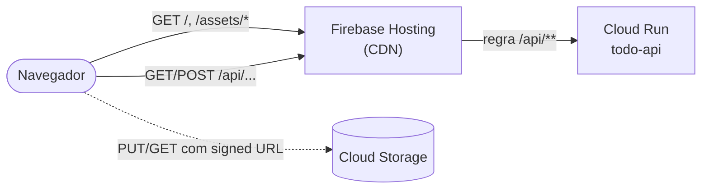

# 10. Firebase Hosting: o front-end na CDN e o rewrite para o Cloud Run

O front (React) é **um punhado de arquivos estáticos**: HTML, JavaScript e CSS. Para isso não precisamos de servidor: o **Firebase Hosting** serve os arquivos por uma **CDN global** com HTTPS automático e um domínio gratuito (`web.app`). E, com uma regra de **rewrite**, ele também encaminha `/api/**` para o Cloud Run, de modo que **navegador, front e API falam com a mesma origem**.

[← Cloud Run](09-cloud-run.md) · [README](../README.md) · [Próximo: Validação, custos e limpeza →](11-validacao-custos-e-limpeza.md)

## Conceitos

| Termo | Explicação |
|---|---|
| **Firebase** | Plataforma do Google construída **sobre o GCP**. Todo projeto Firebase **é** um projeto do Google Cloud; vamos "adicionar o Firebase" ao projeto que já temos |
| **Hosting** | Hospedagem de conteúdo estático + CDN + certificado SSL. Domínios gratuitos: `PROJECT_ID.web.app` e `PROJECT_ID.firebaseapp.com` |
| **Rewrite** | Regra que responde a uma URL com **outro conteúdo**: um arquivo (`/index.html`) ou um serviço (Cloud Run) |
| **Plano Blaze** | Pago por uso, **com as mesmas cotas gratuitas do plano Spark**. Como o projeto já tem faturamento (Cloud Run, Cloud SQL), ele passa para o Blaze |
| **Site (site ID)** | Um site de Hosting. O padrão tem o ID igual ao do projeto |

## Por que o rewrite `/api/**`?



| Sem o rewrite | Com o rewrite |
|---|---|
| Front e API em **domínios diferentes** | Tudo em `https://PROJECT_ID.web.app` |
| Precisa de CORS na API e de `VITE_API_URL` no build | O front chama `/api` (o mesmo código de desenvolvimento) |
| Cookies entre domínios exigem `SameSite=None; Secure` | Sem esse problema |
| A URL do Cloud Run fica exposta no código do front | Fica escondida |

> **Detalhes da documentação oficial que afetam a API:**
> - O Hosting tem **limite de 60 s** por requisição (504 se passar). Por isso o `--timeout=60` do serviço e o **upload direto ao bucket**.
> - Em rewrites para o Cloud Run, os **cookies são removidos**, exceto o chamado `__session`. Por isso o login usa **JWT no cabeçalho `Authorization`**, não cookie.
> - Respostas 404 vindas do serviço são **guardadas no CDN por 10 minutos**, a menos que tragam `Cache-Control`. A API envia `Cache-Control: no-store` em todas as respostas.
> - Requisições dinâmicas (Cloud Run) **não são cacheadas** por padrão; o Hosting adiciona `Cookie` e `Authorization` ao `Vary`.
> - Rewrites para o Cloud Run funcionam em `us-central1` (a região que escolhemos) e em várias outras; `us-central1`, `us-east1`, `us-west1`, `europe-west1` e `asia-east1` são as recomendadas para ficar **junto** do Hosting.

## O que vamos criar

| Item | Valor | Observação |
|---|---|---|
| Projeto Firebase | O **mesmo** `PROJECT_ID` | "Adicionar Firebase" a um projeto do Google Cloud existente |
| Plano | Blaze (pago por uso, cotas gratuitas do Spark) | Automático ao ter faturamento |
| Site | ID = `PROJECT_ID` | `https://<PROJECT_ID>.web.app` e `https://<PROJECT_ID>.firebaseapp.com` |
| Pasta pública | `dist` (saída do `npm run build`) | Definida em `firebase.json` |
| Rewrite 1 | `/api/**` → Cloud Run `todo-api`, `us-central1` | Precisa bater com o [capítulo 9](09-cloud-run.md) |
| Rewrite 2 | `**` → `/index.html` | Rotas do React Router (`/projects/…`, `/s/…`) |
| Cache | `/assets/**` por 1 ano (`immutable`); `index.html` sem cache | Arquivos com hash no nome |
| CLI | `firebase-tools` 15.30.2 (via `npx`) | Nada a instalar |

## Passo 1 — Adicionar o Firebase ao projeto

**Terminal**

```bash
source ~/todo-aula.env

npx --yes firebase-tools@latest login                 # no Cloud Shell: login --no-localhost
npx --yes firebase-tools@latest projects:addfirebase "$PROJECT_ID"
npx --yes firebase-tools@latest projects:list
```

**Console**

1. Acesse o [Console do Firebase](https://console.firebase.google.com/) (URL: `https://console.firebase.google.com/`) e clique em **Comece configurando um Projeto do Firebase**.
2. Na tela **Criar um projeto**, **não** digite um nome novo. Clique no link **Adicionar o Firebase ao projeto do Google Cloud** (abaixo do botão *Continuar*).
3. Em **Selecionar um projeto do Google Cloud**, abra a lista, escolha `Todo Aula` e clique em **Continuar**.
4. Em **Algumas informações para lembrar ao adicionar o Firebase a um projeto do Google Cloud**, leia os avisos (a ação não pode ser desfeita; faturamento e permissões do IAM são compartilhados com o Google Cloud; excluir o projeto no Firebase exclui também o projeto no Google Cloud) e clique em **Continuar**.
5. Em **Confirmar plano de preços do Firebase**, o console informa que, como o projeto já tem faturamento, será usado o plano **Blaze** (pagamento por utilização). Clique em **Confirmar e continuar**.
6. Em **Google Analytics para seu projeto do Firebase**, a opção **Ativar o Google Analytics neste projeto** vem **marcada** (Recomendado). **Desative-a** (não usamos) e clique em **Adicionar o Firebase** (nesta tela o botão pode aparecer como **Continuar**).

> O comando (ou o assistente) também ativa as APIs `firebase.googleapis.com` e `firebasehosting.googleapis.com`.

## Passo 2 — Conferir o `firebase.json`

O arquivo `todo-web/firebase.json` já está pronto (capítulo 1, seção 1.10). Confira que o serviço e a região coincidem com o Cloud Run:

```bash
cd todo-web
grep -n -A3 '"run"' firebase.json
gcloud run services list --region="$REGION" --format="table(metadata.name,status.url)"
```

| No `firebase.json` | Deve ser igual a |
|---|---|
| `"serviceId": "todo-api"` | Nome do serviço no Cloud Run (`$SERVICE`) |
| `"region": "us-central1"` | Região do serviço (`$REGION`) |

## Passo 3 — Gerar o build do front

```bash
cd todo-web
npm ci
npm run build          # gera a pasta dist/ (TypeScript + Vite)
ls dist dist/assets
```

O código do front chama sempre `/api`, então **não há variável de ambiente a configurar** para produção.

## Passo 4 — Criar o site e publicar

Este passo tem três partes, **sempre nesta ordem**: **4.1** garantir que o site do Hosting existe, **4.2** publicar o build e **4.3** conferir o resultado no painel. Em cada parte, **Terminal** e **Console** são **caminhos equivalentes** (faça um dos dois), exceto onde o texto avisar que o Console não faz aquilo.

### 4.1 — Ativar o site do Hosting (só no primeiro uso)

A partir de outubro de 2026, o Firebase **não cria mais o site padrão automaticamente** em projetos novos (o console avisa: *"o provisionamento do site padrão será feito sob demanda"*). Sem esse site, o deploy do passo 4.2 falha. Primeiro, veja se ele já existe:

```bash
npx --yes firebase-tools@latest hosting:sites:list --project "$PROJECT_ID"
```

Se a lista já mostrar um site com ID `<PROJECT_ID>`, **pule para o 4.2**. Se vier vazia, crie o site por um dos caminhos abaixo.

**Terminal**

```bash
npx --yes firebase-tools@latest hosting:sites:create "$PROJECT_ID" --project "$PROJECT_ID"
npx --yes firebase-tools@latest hosting:sites:list --project "$PROJECT_ID"    # confirma
```

**Console**

1. Em **Hospedagem e sem servidor** → **Hosting** (ou `https://console.firebase.google.com/project/<PROJECT_ID>/hosting`), clique em **Vamos começar**.
2. O assistente mostra os passos de instalar a CLI, inicializar e implantar. **Não precisamos executá-los** (o `firebase.json` já existe): avance com **Próxima** até concluir e clique em **Continuar para o console**.
3. Confirme que o painel passou a listar o domínio `<PROJECT_ID>.web.app`.

> O assistente do Console **só cria o site**; ele não publica nada. O painel ainda ficará sem versões até o passo 4.2.

> Se o site ID **não** for igual ao `PROJECT_ID`, ajuste as origens no CORS do bucket ([capítulo 6](06-cloud-storage.md)) e a variável `CORS_ORIGINS` do serviço.

### 4.2 — Publicar o build

**Terminal**

```bash
cd todo-web
npx --yes firebase-tools@latest deploy --only hosting --project "$PROJECT_ID"
```

A saída termina com:

```text
Project Console: https://console.firebase.google.com/project/<PROJECT_ID>/overview
Hosting URL: https://<PROJECT_ID>.web.app
```

**Console**

**Não existe.** O Console do Firebase **não envia arquivos**: o deploy é feito pela CLI. O painel serve para acompanhar e reverter (4.3).

### 4.3 — Conferir no painel

**Terminal**

```bash
npx --yes firebase-tools@latest hosting:sites:list --project "$PROJECT_ID"
curl -sI "https://$PROJECT_ID.web.app" | head -n 1      # HTTP/2 200
```

**Console**

Abra `https://console.firebase.google.com/project/<PROJECT_ID>/hosting` (menu **Hospedagem e sem servidor** → **Hosting**). O painel mostra os domínios, o **histórico de versões** (agora com o deploy do 4.2) e o botão de **reversão** para uma versão anterior.

## Passo 5 — Testar de ponta a ponta

```bash
export SITE_URL="https://$PROJECT_ID.web.app"

curl -s "$SITE_URL/api/health"          # {"status":"ok"}              (passou pelo rewrite)
curl -s "$SITE_URL/api/health/ready"    # {"status":"ok","postgres":"up","mongo":"up"}
curl -sI "$SITE_URL/projects/qualquer"  # 200 (fallback do React Router)
```

No navegador, abra `https://<PROJECT_ID>.web.app` e:

1. **Crie uma conta** e um projeto.
2. Adicione uma tarefa e **anexe uma imagem** (o navegador faz `PUT` no Cloud Storage: abra as *Ferramentas do desenvolvedor → Rede* para ver).
3. Clique em **Compartilhar**, gere um link e **abra-o em janela anônima**.

O roteiro completo de validação está no [capítulo 11](11-validacao-custos-e-limpeza.md).

## Problemas comuns

| Sintoma | Causa provável | Solução |
|---|---|---|
| `/api/...` devolve a página do React em vez de JSON | Regra `**` antes de `/api/**`, ou rewrite ausente | A **ordem** importa: `/api/**` vem primeiro |
| `/api/...` devolve `403` | Serviço exige autenticação do Cloud Run | `gcloud run services update "$SERVICE" --no-invoker-iam-check` |
| `Cloud Run service ... not found` / erro de região | `serviceId` ou `region` diferentes do serviço | Alinhe o `firebase.json` e refaça o deploy |
| `504` em alguma rota | Passou de 60 s | Otimize a rota (upload já vai direto ao bucket) |
| `blocked by CORS policy` no upload de arquivo | CORS do **bucket** sem a origem `web.app` | [Capítulo 6, passo 2](06-cloud-storage.md#passo-2--configurar-o-cors) |
| Depois de sair e voltar, a tela pede login | Token só existe no `localStorage` do navegador daquele domínio | Esperado; o token vale 1 dia |
| Página antiga após novo deploy | Cache do navegador | O `index.html` é `no-cache`; force a atualização (Ctrl+F5) |
| Deploy pede login/permite só o Console | Sessão do `firebase login` expirou | Refaça o login |

## Custos deste capítulo

Fontes: [preços do Firebase](https://firebase.google.com/pricing) e [Cloud Run](https://cloud.google.com/run/pricing), consultadas em 20/09/2026.

| Item | Preço oficial | Cota gratuita | Estimativa mensal |
|---|---|---|---|
| Hosting: armazenamento | US$ 0,026/GB acima da cota | 10 GB | Nosso build tem ~0,3 MB → **US$ 0,00** |
| Hosting: transferência | US$ 0,15/GB acima da cota | 360 MB/dia | ~90 KB compactados por primeira visita (≈ 4.000 visitas/dia dentro da cota) → **US$ 0,00** |
| Domínio `web.app` e certificado SSL | Sem cobrança | — | US$ 0,00 |
| Requisições `/api` pelo rewrite | Cobradas como **Cloud Run** ([capítulo 9](09-cloud-run.md)) | 2 M requisições | US$ 0,00 |
| Taxa fixa do plano Blaze | Não há (paga-se só o uso) | — | US$ 0,00 |
| **Total** | | | **US$ 0,00** |

> O plano **Blaze** não tem mensalidade: ele apenas permite cobrar o que passar das cotas gratuitas. Continue com o alerta de orçamento do [capítulo 2](02-projeto-gcp-e-ferramentas.md).

---

[← Cloud Run](09-cloud-run.md) · [README](../README.md) · [Próximo: Validação, custos e limpeza →](11-validacao-custos-e-limpeza.md)
