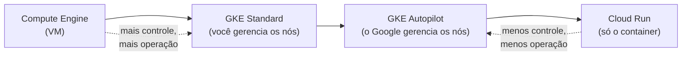
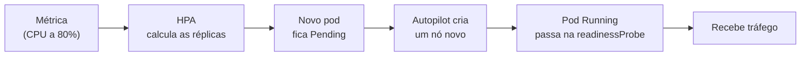

# 12. (Opcional) Cloud Run × Kubernetes: escalabilidade, custos e migração

Até aqui a API do Todo roda no **Cloud Run**. Este capítulo responde a uma pergunta que todo time faz cedo ou tarde: *"e se eu levasse isso para o Kubernetes?"*. Vamos comparar os dois modelos, mostrar **como a `todo-api` seria transformada** e discutir **o que se ganha, o que se perde e quanto custa**.

[← Validação, custos e limpeza](11-validacao-custos-e-limpeza.md) · [README](../README.md)

> **Este capítulo é comparativo: não há nada para executar e nada para pagar.** Os comandos e manifestos YAML estão aqui para você **ler e entender a implementação**, não para aplicar no projeto da aula. O roteiro principal termina no [capítulo 11](11-validacao-custos-e-limpeza.md); este é uma leitura de aprofundamento.

## O que você vai aprender

| Pergunta | Seção |
|---|---|
| Quando faz sentido sair do Cloud Run? | [1](#1-preciso-de-kubernetes) |
| Onde Cloud Run, GKE e VMs se posicionam? | [2](#2-o-espectro-de-abstração) |
| Cada conceito do Cloud Run tem qual equivalente no Kubernetes? | [3](#3-conceitos-lado-a-lado) |
| Como cada um escala, e o que limita a escala do Todo? | [4](#4-escalabilidade-comparada) |
| O que quebra na migração? | [5](#5-o-que-quebra-na-migração) |
| Deploy, rollback, logs e métricas mudam como? | [6](#6-deploy-rollback-e-cicd) e [7](#7-observabilidade) |
| Benefícios, limitações e custos | [8](#8-benefícios-e-limitações) e [9](#9-custos) |
| Como migrar com segurança (e voltar)? | [11](#11-caminho-de-migração-e-rollback) |
| Resumo e perguntas e respostas | [12](#12-resumo-perguntas-e-respostas) |
| Como a `todo-api` vira manifestos do Kubernetes? | [13](#13-transformando-a-todo-api-em-kubernetes) |

## 1. Preciso de Kubernetes?

Na maioria dos casos, **não**. O Cloud Run já entrega o que o Todo precisa: container, HTTPS, escala automática, escala a zero e cobrança por uso. Kubernetes passa a valer a pena quando você precisa de algo que o Cloud Run não oferece ou quando o custo por uso deixa de compensar.

| Fique no Cloud Run quando… | Considere Kubernetes quando… |
|---|---|
| O tráfego é irregular ou baixo (escalar a zero economiza) | O tráfego é **alto e constante**, e o cluster fica bem ocupado o dia todo |
| A aplicação é um ou poucos serviços HTTP sem estado | Há **dezenas de serviços** que precisam de rede, políticas e ciclo de vida padronizados |
| O time é pequeno e não quer operar infraestrutura | Há um **time de plataforma** que opera clusters |
| O container responde a requisições HTTP/gRPC | Você precisa de **StatefulSets, DaemonSets, sidecars complexos, operadores (CRDs)** ou protocolos além de HTTP |
| Você quer pagar só pelo uso | Você precisa de **portabilidade** entre nuvens e on-premises com a mesma API |
| O Cloud Run atende aos limites de CPU, memória e tempo | Você precisa de **controle fino** de agendamento, afinidade, GPU, redes e segurança do pod |

**Para o Todo:** a decisão correta é **ficar no Cloud Run**. É um serviço HTTP sem estado, com tráfego baixo e um time de uma pessoa. A migração descrita aqui é um exercício de aprendizado, e o resto do capítulo mostra por quê.

## 2. O espectro de abstração

Não é uma escolha entre "Cloud Run **ou** Kubernetes". Existem degraus entre os dois, e cada degrau entrega mais controle e cobra mais operação.



| | Compute Engine | GKE Standard | GKE Autopilot | Cloud Run |
|---|---|---|---|---|
| **Você gerencia** | SO, rede, escala, deploy | Pools de nós, versões, escala dos nós, YAML | YAML dos workloads, escala dos pods | O container e sua configuração |
| **O Google gerencia** | O hardware | Plano de controle | Plano de controle **e nós** | Tudo abaixo do container |
| **Unidade de cobrança** | VM por segundo | Nós (VMs) + taxa do cluster | **Recursos pedidos pelos pods** + taxa do cluster | CPU/memória/requisições em uso |
| **Escala a zero** | Não | Não (o cluster continua) | Não (a taxa do cluster e o plano de controle continuam) | **Sim** |
| **Linguagem de configuração** | Scripts, Terraform | YAML do Kubernetes | YAML do Kubernetes | `gcloud` / YAML do Cloud Run |

> Este capítulo compara o **Cloud Run** com o **GKE Autopilot**, o degrau de Kubernetes mais próximo do Cloud Run, em que você não administra servidores. O Standard dá mais controle e exige mais operação.

## 3. Conceitos lado a lado

| No Cloud Run (capítulo 9) | No Kubernetes | Observação |
|---|---|---|
| **Serviço** (`todo-api`) | **Deployment** + **Service** | O Deployment mantém os pods; o Service dá um endereço estável |
| **Revisão** (imutável) | **ReplicaSet** (um por versão do Deployment) | O Kubernetes guarda um histórico de ReplicaSets para o *rollback* |
| **Instância** | **Pod** | Um pod pode ter vários containers (o *sidecar*) |
| **Job** (`todo-api-migrate`) | **Job** | Mesma ideia: roda até terminar |
| `--min-instances` / `--max-instances` | `minReplicas` / `maxReplicas` do **HPA** | O HPA é o autoescalonador de pods |
| `--concurrency=40` | **Não existe equivalente direto** | O pod recebe o que o balanceador mandar. Você controla por CPU/memória e pelo HPA |
| `--cpu` / `--memory` | `resources.requests` / `limits` | No Autopilot, os *requests* definem a cobrança |
| `--startup-probe` | `startupProbe`, `livenessProbe`, `readinessProbe` | O Kubernetes distingue **três** testes |
| `--set-secrets` | **Secret** (ou o complemento do Secret Manager) | Um Secret do Kubernetes é um objeto do cluster |
| `--service-account` | **ServiceAccount** + **Workload Identity** | Ver [seção 5.1](#51-identidade-dos-pods-workload-identity) |
| URL `https://...run.app` | **Service** + **Ingress** + domínio + certificado | Não vem pronta (seção [5.2](#52-o-firebase-hosting-não-aponta-para-o-gke)) |
| Direct VPC egress | Cluster **VPC-native** | Os pods recebem IPs da sua sub-rede |
| `gcloud run services logs read` | `kubectl logs` + Cloud Logging | |
| `update-traffic --to-revisions=...` | `kubectl rollout undo` | Seção [6](#6-deploy-rollback-e-cicd) |

### Glossário rápido

| Termo | Explicação |
|---|---|
| **Cluster** | O conjunto formado pelo plano de controle (cérebro) e os nós (máquinas que rodam os pods) |
| **Nó** | Uma máquina (VM) do cluster. No Autopilot você não a vê nem a escolhe |
| **Pod** | A menor unidade: um ou mais containers que compartilham rede e armazenamento. É o equivalente à "instância" |
| **Deployment** | Declara "quero N cópias deste pod" e cuida das atualizações |
| **ReplicaSet** | Mantém o número de pods de **uma versão**. O Deployment cria um por versão |
| **Service** | Endereço de rede estável para um conjunto de pods |
| **Ingress** | Regra que expõe um Service para a internet por um balanceador HTTP(S) |
| **HPA** | *Horizontal Pod Autoscaler*: muda o número de réplicas conforme uma métrica |
| **Namespace** | "Pasta" lógica para separar recursos no cluster |
| **Manifesto** | Arquivo YAML que descreve o estado desejado de um objeto |
| **Probe** | Teste de saúde: *startup* (já subiu?), *liveness* (está vivo?), *readiness* (pode receber tráfego?) |

## 4. Escalabilidade comparada

Esta é a diferença mais importante entre os dois. Vamos partir dos valores reais do [capítulo 9](09-cloud-run.md): 1 vCPU, 512 MiB, **concorrência 40**, **mínimo 0**, **máximo 2**.

### 4.1 Como o Cloud Run escala

- A unidade de escala é a **instância**. O Cloud Run cria uma instância nova quando as instâncias existentes passam do alvo de **concorrência** (e de CPU). Segundo a [documentação de autoescala](https://docs.cloud.google.com/run/docs/about-instance-autoscaling), o alvo padrão é de **60%** da capacidade.
- **Sem tráfego, vai a zero.** A próxima requisição paga um *cold start*: o tempo de criar a instância e subir o container. Com `--min-instances=1` o cold start some, mas você paga a instância ociosa (≈ US$ 9,72/mês, capítulo 9).
- **Tudo é automático.** Você só define os limites (`min`, `max`, `concurrency`).
- **O teto é seu.** Por padrão o limite é de 100 instâncias por revisão; no Todo definimos `max=2` por causa do banco.
- Acima do teto, as requisições **esperam em fila por pouco tempo** e depois falham.

### 4.2 Como o Kubernetes escala

O Kubernetes escala em **três níveis independentes**, e cada um pode ser o gargalo:



1. **Pods (HPA).** O HPA compara a métrica atual com o alvo e calcula:
   `réplicas desejadas = ceil(réplicas atuais × métrica atual ÷ métrica alvo)`.
   A CPU é medida **em relação ao `request`**, então o HPA por CPU só funciona se os *requests* estiverem definidos.
2. **Nós.** Se o novo pod não cabe nos nós existentes, ele fica `Pending` até haver capacidade. No **Autopilot** o Google cria o nó para você; no **Standard** é o *cluster autoscaler* do seu pool de nós.
3. **Escala a zero.** O HPA padrão **não** escala a zero (o mínimo é 1 réplica). Para isso existem componentes adicionais (como o KEDA), que você instala e opera. Mesmo assim, o cluster em si continua cobrando.

Valores padrão úteis do HPA: ele reavalia a cada ~15 s, e, ao **reduzir**, espera uma janela de estabilização (padrão de 300 s) para não oscilar.

### 4.3 Comparativo

| Aspecto | Cloud Run | GKE Autopilot |
|---|---|---|
| **Unidade que escala** | Instância (1 container) | Pod (1 ou mais containers) |
| **Quem decide** | O Cloud Run, a partir das requisições | O **HPA**, a partir de métricas que você escolhe |
| **Métrica padrão** | Concorrência e CPU (alvo de 60%) | Nenhuma: você declara o HPA |
| **Escala a zero** | **Nativo** | Não nativo (exige KEDA ou similar) |
| **Mínimo prático** | 0 | 1 a 2 pods, **sempre cobrando** |
| **Granularidade** | Por requisição | Por pod, e sempre dentro dos recursos pedidos |
| **Velocidade de reação** | Segundos (cold start) | Segundos se há nó livre; **mais** se o nó precisa ser criado |
| **Teto** | `--max-instances` | `maxReplicas` + cotas e IPs do cluster |
| **Concorrência por unidade** | Configurável (`--concurrency`) | Definida pelo app e pelo balanceador |
| **Métricas customizadas** | Limitadas | **Amplas** (CPU, memória, fila, métricas do Prometheus) |
| **Tipo de carga** | Requisição/resposta, jobs | Qualquer: serviços, filas, lotes, stateful |

### 4.4 O gargalo real do Todo é o banco

Escalar a API sem escalar o banco só **muda o gargalo de lugar**. O `db-f1-micro` aceita poucas conexões, e cada réplica abre até `DB_POOL_MAX` conexões:

`conexões máximas = DB_POOL_MAX × número de réplicas`

| Plataforma | Conta | Resultado |
|---|---|---|
| Cloud Run (capítulo 9) | `DB_POOL_MAX=3` × `--max-instances=2` | **6 conexões** |
| Kubernetes, mesmo teto | `DB_POOL_MAX=2` × `maxReplicas=3` | **6 conexões** |
| Kubernetes sem limite no HPA | `DB_POOL_MAX=3` × 10 réplicas | **30 conexões**: o banco recusa (`too many connections`) |

Isso vale nos dois mundos, mas no Kubernetes o erro é mais fácil de cometer, porque **o HPA escala sozinho e o cluster aceita**. Para escalar de verdade é preciso escalar o banco (instância maior) ou colocar um *pooler* de conexões (como o PgBouncer) na frente dele.

Outro detalhe da própria aplicação, no [app.module.ts](../todo-api/src/app.module.ts): o *rate limit* do `ThrottlerModule` (120 requisições por minuto) usa **contadores em memória**. Cada instância (ou pod) tem o seu. Com N réplicas, o limite efetivo por cliente é de até **N × 120**. Isso aparece nos dois modelos e só se resolve com um contador compartilhado (por exemplo, Redis).

### 4.5 Tempo de reação: o que medir

| Evento | Cloud Run | Kubernetes (Autopilot) |
|---|---|---|
| Primeira requisição com tudo parado | *Cold start* de alguns segundos | Não acontece (há pods ligados) |
| Pico de tráfego | Nova instância em segundos | HPA (≈ 15 s) + pod novo + **possivelmente um nó novo** (tempo maior) |
| Fim do pico | Instâncias somem rápido | Janela de estabilização do HPA (≈ 5 min) |

Os tempos exatos dependem da imagem, da região e da carga. **Meça no seu ambiente** (por exemplo, com uma ferramenta de teste de carga) em vez de confiar em números genéricos.

## 5. O que quebra na migração

Estes são os pontos em que a migração costuma travar. Nenhum é difícil, mas todos são **invisíveis até você tentar**.

### 5.1 Identidade dos pods (Workload Identity)

No Cloud Run, `--service-account=todo-api-sa` basta. A conta serve para ler os segredos, escrever no bucket e **assinar as signed URLs** (capítulo 7).

No GKE, o pod não herda uma conta de serviço do Google automaticamente. O **Workload Identity Federation for GKE** (no Autopilot, ele está sempre ligado) permite que o pod assuma uma identidade do Google, de **duas formas**:

| Forma | Como funciona | Serve para o Todo? |
|---|---|---|
| **Acesso direto** | Você concede papéis do IAM diretamente à identidade (principal) da ServiceAccount do Kubernetes | A documentação do Google a indica como o caminho preferido, mas **a assinatura de URLs precisa de um e-mail de conta de serviço**, que esse modo não tem |
| **Vínculo com uma conta de serviço** | A ServiceAccount do Kubernetes é anotada e recebe `roles/iam.workloadIdentityUser` sobre a conta `todo-api-sa` | **Sim.** O pod passa a agir como `todo-api-sa`, e as permissões do capítulo 7 continuam valendo, inclusive `serviceAccountTokenCreator` na própria conta |

O código de [gcs-storage.service.ts](../todo-api/src/storage/gcs-storage.service.ts) não muda: ele usa as *Application Default Credentials*, e o GKE as fornece pelo servidor de metadados. **Os dois ajustes (a anotação e o papel `workloadIdentityUser`) são obrigatórios**; sem um deles, a API sobe, mas falha ao assinar URLs.

### 5.2 O Firebase Hosting não aponta para o GKE

O `rewrite /api/**` do [capítulo 10](10-firebase-hosting.md) funciona porque o destino é um **serviço do Cloud Run** (`"run": { "serviceId": "todo-api" }`). A documentação do Hosting lista Cloud Run e Cloud Functions como destinos dinâmicos; **não existe destino "GKE"**.

Com a API no GKE, você perde as vantagens da tabela do capítulo 10:

| Com o rewrite (Cloud Run) | Sem o rewrite (GKE) |
|---|---|
| Tudo em `https://PROJECT_ID.web.app` | Front em `web.app` e API em **outro domínio** (`api.SEU_DOMINIO`) |
| Sem CORS | **CORS obrigatório** (`CORS_ORIGINS`) |
| O front chama `/api` | O front precisa de `VITE_API_URL` no build |
| A URL da API fica escondida | A URL da API fica exposta |
| Sem problema de cookies entre domínios | Cookies entre domínios exigem `SameSite=None; Secure` (a API usa JWT em cabeçalho, então não depende disso) |
| HTTPS automático | Você precisa de **domínio próprio** + certificado gerenciado |

Duas saídas possíveis:

| Saída | Descrição | Custo de mudança |
|---|---|---|
| **A. Front no Hosting, API em subdomínio** | É o caminho descrito neste capítulo | CORS, `VITE_API_URL`, domínio e DNS |
| **B. Tudo atrás do mesmo balanceador** | O front sai do Hosting e o balanceador serve o front (por exemplo, de um bucket com CDN) e a API em caminhos diferentes | Mais mudanças: o Firebase deixa de ser usado |

### 5.3 Migrations

O capítulo 9 impõe uma ordem: **migrar antes de subir a API**. No Kubernetes há três jeitos de fazer isso, cada um com um cuidado:

| Jeito | Como | Cuidado |
|---|---|---|
| **Job + espera** (o usado aqui) | `kubectl apply` do Job, `kubectl wait`, e só então o Deployment | O nome do Job é imutável: use um novo por versão (ou apague o antigo) |
| **`initContainer`** | Um container que roda **antes** da API, **em cada pod** | Cada pod novo roda a migration (de novo): lento e fonte de falhas em cascata |
| **Passo do pipeline** | O CI/CD roda a migration antes do `kubectl apply` | Exige que o pipeline alcance o banco privado |

O Job é o análogo mais direto do **Cloud Run Job** do capítulo 9.

### 5.4 Rede e dados

| Tema | No Cloud Run | No GKE |
|---|---|---|
| **IPs dos workloads** | Direct VPC egress usa uma sub-rede `/24` | Um cluster **VPC-native** usa **intervalos secundários** da sub-rede (um para pods, outro para serviços). Planeje o tamanho: ele limita quantos pods cabem |
| **Cloud SQL (IP privado)** | Pela VPC, via peering do capítulo 3 | O pod também sai pela VPC. Como o cluster é VPC-native, os IPs dos pods pertencem à sub-rede. Confirme em laboratório que o peering anuncia os intervalos secundários |
| **MongoDB Atlas (M0, IP público)** | Sai pela internet; o Atlas aceita `0.0.0.0/0` no laboratório | Os pods saem pelo IP dos **nós**, que **muda**. Um IP fixo para o Atlas exige **Cloud NAT** (e, em cluster privado, o NAT é obrigatório para falar com a internet) |
| **Entrada** | URL pública do serviço | **Balanceador** + IP estático + DNS |

Uma alternativa ao acesso direto ao Cloud SQL é o **Cloud SQL Auth Proxy** como *sidecar*, que cria a conexão autenticada e criptografada. Ele adiciona um segundo container por pod (e custo de recursos), mas é um padrão muito comum.

### 5.5 Segredos

| Opção | Como | Compromisso |
|---|---|---|
| **Secret do Kubernetes** (usado aqui) | Você copia os valores do Secret Manager para o cluster | Simples, mas há **duas cópias** dos segredos. Girar uma senha significa atualizar as duas e reiniciar os pods |
| **Complemento do Secret Manager** (CSI) | O segredo é **montado como arquivo** dentro do pod | Uma única fonte da verdade, mas a API lê `DATABASE_URL` de **variável de ambiente**: seria preciso adaptar a aplicação ou o entrypoint |

No Cloud Run, o `--set-secrets` faz tudo isso de uma vez e com versão fixa. Esse é um caso em que o gerenciado simplifica.

### 5.6 Detalhes que mudam o comportamento

| Detalhe | O que observar |
|---|---|
| **`TRUST_PROXY_HOPS`** | O IP real do cliente vem do cabeçalho `X-Forwarded-For`, e o `ThrottlerModule` usa esse IP. Cada proxy na frente (balanceador, ingress controller) altera o número de saltos. Valor errado: todos os clientes parecem ter o mesmo IP (ou o IP é forjável) |
| **Rate limit por pod** | Veja a [seção 4.4](#44-o-gargalo-real-do-todo-é-o-banco): o limite vale por pod |
| **Encerramento** | O Kubernetes envia `SIGTERM` e espera `terminationGracePeriodSeconds`. A API já está preparada (`enableShutdownHooks`) |
| **Atualização do cluster** | O Autopilot atualiza os nós por conta própria; seus pods podem ser **reagendados**. Mantenha 2 réplicas e um `PodDisruptionBudget` para não ficar sem pods |
| **Timeout** | O limite de 60 s do Hosting some, mas o balanceador tem o seu (30 s por padrão, configurável) |

## 6. Deploy, rollback e CI/CD

| Ação | Cloud Run | Kubernetes |
|---|---|---|
| **Publicar versão nova** | `gcloud run deploy --image=...:1.0.1` | `kubectl set image` ou `kubectl apply` com a nova imagem |
| **Estratégia padrão** | Nova revisão recebe 100% do tráfego (ou o que você definir) | **Rolling update**: pods novos entram e os antigos saem aos poucos |
| **Dividir tráfego (canário)** | **Nativo**: `--to-revisions=A=90,B=10` | Não é nativo no Deployment. Usa-se Gateway API com pesos, ou ferramentas como Argo Rollouts |
| **Ver o histórico** | `gcloud run revisions list` | `kubectl rollout history deployment/todo-api -n todo` |
| **Rollback** | `update-traffic --to-revisions=REVISAO=100` | `kubectl rollout undo deployment/todo-api -n todo` |
| **Acompanhar** | Console: revisões | `kubectl rollout status deployment/todo-api -n todo` |

O [cloudbuild.yaml](../todo-api/cloudbuild.yaml) atual só **constrói** as imagens. Para publicar no GKE, o pipeline ganharia passos de deploy, por exemplo:

```yaml
# Ilustrativo: passos extras no cloudbuild.yaml
  - id: deploy
    name: gcr.io/cloud-builders/kubectl
    args: ['set', 'image', 'deployment/todo-api', 'api=${_REGISTRY}/todo-api:${_TAG}', '-n', 'todo']
    env:
      - 'CLOUDSDK_COMPUTE_REGION=us-central1'
      - 'CLOUDSDK_CONTAINER_CLUSTER=todo-gke'
```

A conta do Cloud Build precisaria de permissão no cluster (por exemplo, `roles/container.developer`). Em projetos maiores, o passo seguinte é o **GitOps**: o repositório guarda os manifestos e uma ferramenta (Argo CD, Config Sync) aplica as mudanças no cluster.

## 7. Observabilidade

| Necessidade | Cloud Run | GKE |
|---|---|---|
| **Logs do container** | `gcloud run services logs read` e aba *Registros* | `kubectl logs` e o Cloud Logging, para onde os logs vão automaticamente |
| **Métricas** | Painel *Métricas* pronto (requisições, latência, instâncias, CPU) | Cloud Monitoring (CPU, memória, reinícios). Métricas da aplicação exigem configurar coleta (Prometheus gerenciado) |
| **Eventos** | Revisões e deploys | `kubectl describe pod` e `kubectl get events`: aqui aparecem `OOMKilled`, `CrashLoopBackOff`, `Pending` |
| **Alertas** | Políticas do Cloud Monitoring | Idem, mais alertas sobre o cluster |
| **Depurar um problema** | Ler o log da revisão | Descer camadas: pod → deployment → service → ingress → balanceador |

Resumo: no Cloud Run há **uma camada** para depurar; no Kubernetes há **várias**, e saber em qual delas está o problema é uma habilidade que se aprende com o tempo.

## 8. Benefícios e limitações

### O que o Kubernetes oferece a mais

| Benefício | Exemplo |
|---|---|
| **Portabilidade** | O mesmo YAML roda em outras nuvens ou on-premises |
| **Controle fino** | Afinidade, tolerâncias, topologia entre zonas, políticas de rede |
| **Ecossistema** | Operadores, Helm, malhas de serviço, ferramentas de GitOps |
| **Tipos de carga** | StatefulSets, DaemonSets, sidecars, protocolos não HTTP |
| **Métricas de escala à escolha** | Fila, métricas customizadas |
| **Custo previsível sob carga alta e constante** | Seção [9](#9-custos) |

### O que o Kubernetes tira ou complica

| Limitação | Efeito para o Todo |
|---|---|
| **Sem escala a zero nativa** | Custo mínimo permanente |
| **Mais peças para operar** | Cluster, rede, ingress, certificado, DNS, HPA, probes |
| **Curva de aprendizado** | O time precisa aprender os conceitos da seção 3 |
| **Mais superfície de erro** | Os pontos da seção 5 |
| **O Firebase Hosting deixa de ser a entrada** | CORS, domínio e `VITE_API_URL` |
| **Menos "mágica" gerenciada** | Segredos, domínio e certificado viram trabalho seu |

## 9. Custos

> **Atenção:** os valores abaixo são de `us-central1`, com 730 horas por mês, consultados em 08/11/2026. Os preços do **Cloud Run** são os já usados no [capítulo 9](09-cloud-run.md) (consultados em 20/09/2026). Do **GKE Autopilot**, o preço de **vCPU** (US$ 0,0445 por hora) aparece na [página oficial de preços do GKE](https://cloud.google.com/kubernetes-engine/pricing). Os de **memória** (US$ 0,0049225 por GiB-hora), a **taxa do cluster** (US$ 0,10 por hora) e o **crédito mensal** (US$ 74,40) foram obtidos de **fontes secundárias** e **não pude confirmá-los na página do Google**. Os do **balanceador** (US$ 0,025 por hora para as 5 primeiras regras) vêm da [página oficial](https://cloud.google.com/load-balancing/pricing), mas **não confirmei o preço do tráfego processado**. **Confira tudo na página oficial antes de decidir com dinheiro de verdade.**

### 9.1 Preços usados

| Item | Preço | Fonte |
|---|---|---|
| Cloud Run: CPU (cobrança por requisição) | US$ 0,000024 por vCPU-s (≈ US$ 0,0864 por vCPU-hora) | Capítulo 9 |
| Cloud Run: memória (cobrança por requisição) | US$ 0,0000025 por GiB-s (≈ US$ 0,009 por GiB-hora) | Capítulo 9 |
| Autopilot: vCPU | US$ 0,0445 por vCPU-hora | Página oficial do GKE |
| Autopilot: memória | US$ 0,0049225 por GiB-hora | Fonte secundária |
| Autopilot: taxa do cluster | US$ 0,10 por hora (≈ US$ 73,00 por mês) | Fonte secundária |
| Crédito do nível gratuito | US$ 74,40 por mês, por conta de faturamento, cobre a taxa de **1** cluster Autopilot ou zonal | Fonte secundária |
| Balanceador: regras de encaminhamento | US$ 0,025 por hora (≈ US$ 18,25 por mês) | Página oficial |

### 9.2 Quanto custa um pod

O Autopilot cobra o que o pod **pede**, e não o que usa:

| Pod | Cálculo (por hora) | Por mês |
|---|---|---|
| Mínimo (0,25 vCPU, 0,5 GiB) | 0,25 × 0,0445 + 0,5 × 0,0049225 ≈ US$ 0,01359 | ≈ **US$ 9,92** |
| **Do exemplo (0,5 vCPU, 1 GiB)** | 0,5 × 0,0445 + 1 × 0,0049225 ≈ US$ 0,02717 | ≈ **US$ 19,84** |
| Equivalente ao Cloud Run (1 vCPU; a memória sobe de 0,5 para 1 GiB) | 1 × 0,0445 + 1 × 0,0049225 ≈ US$ 0,04942 | ≈ **US$ 36,08** |

Fica de fora o armazenamento temporário do pod (centavos por mês).

### 9.3 Cenários

| Cenário | Cloud Run | GKE Autopilot |
|---|---|---|
| **Este roteiro** (2.000 requisições/mês) | **US$ 0,00** (cota gratuita) | 2 pods do exemplo (≈ 39,67) + balanceador (≈ 18,25) ≈ **US$ 57,92**. A taxa do cluster fica coberta pelo crédito |
| **Uso leve** (300 mil requisições/mês) | **US$ 0,00** | **≈ US$ 57,92** (o custo não depende do uso) |
| **Sem *cold start*** | 1 instância mínima: **≈ US$ 9,72** | Já incluído: os 2 pods estão sempre ligados |
| **Uma vCPU ocupada o mês inteiro** | 2.628.000 s × US$ 0,000024 + 0,5 GiB × 2.628.000 s × US$ 0,0000025 ≈ **US$ 66,36** | 1 pod de 1 vCPU/1 GiB ≈ **US$ 36,08** |
| **Um segundo cluster** | Não se aplica | + US$ 73,00 por mês de taxa (o crédito cobre **um** cluster) |

> O banco (Cloud SQL, ≈ US$ 9,37 por mês) e o resto da infraestrutura custam o mesmo nos dois casos e ficam fora da tabela.

### 9.4 Onde está o ponto de virada

Por **vCPU-hora**, a cobrança por requisição do Cloud Run (≈ US$ 0,0864) é cerca de **1,9 vez** a do Autopilot (US$ 0,0445). Mas o Cloud Run só cobra **enquanto há requisição em andamento**, e o Autopilot cobra **o tempo todo**. Daí a regra de bolso:

> Se a CPU do serviço está **ocupada em mais de ~50% do tempo** (0,0445 ÷ 0,0864 ≈ 0,51), o Autopilot tende a ficar mais barato. Abaixo disso, o Cloud Run tende a ser mais barato.

Esta é uma **aproximação**, não uma lei. Ela ignora a cota gratuita do Cloud Run, o modo de cobrança **por instância** do Cloud Run (com tarifas menores, que não usamos no roteiro), os descontos por uso contínuo do GKE e o custo do balanceador. Para o Todo, com tráfego baixo, o Cloud Run ganha com folga.

### 9.5 O custo que não aparece na fatura

| Custo | Descrição |
|---|---|
| **Aprendizado** | Semanas até o time dominar conceitos, depuração e boas práticas do Kubernetes |
| **Operação** | Acompanhar atualizações do cluster, cotas, alertas e incidentes |
| **Plantão** | Mais camadas significam mais lugares onde algo pode falhar de madrugada |
| **Manutenção dos manifestos** | YAML, versões de API e ferramentas auxiliares |

Em muitos times esse custo **pesa mais que a fatura da nuvem**. Para um time pequeno, ele costuma ser o argumento decisivo para ficar no Cloud Run.

## 10. Operação e riscos

| Risco | Como se manifesta | Mitigação |
|---|---|---|
| **Cluster esquecido** | Cobrança 24 h por dia, mesmo sem tráfego | Orçamento com alerta (capítulo 2) e **apagar o cluster** ao terminar um laboratório |
| **Escala sem limite** | HPA cria pods até estourar as conexões do banco | `maxReplicas` coerente com `DB_POOL_MAX` e a capacidade do banco |
| **Pod não sobe** | `Pending`, `CrashLoopBackOff` ou `ImagePullBackOff` | `kubectl describe pod` e `kubectl logs` |
| **Pod é encerrado por falta de memória** | `OOMKilled` | Revisar `limits` e o consumo da aplicação |
| **Atualização do cluster** | Pods reagendados no meio da operação | 2 ou mais réplicas e `PodDisruptionBudget` |
| **Segredo exposto** | Valores em YAML versionado | Criar segredos por comando ou usar o complemento do Secret Manager |
| **Configuração permissiva** | Contas com papéis amplos | Menor privilégio, como nos capítulos 7 e 9 |

Sobre segurança, o Autopilot já aplica boas práticas por padrão (por exemplo, restringe containers privilegiados), mas a **responsabilidade é compartilhada**: o Google protege o plano de controle e os nós; **você** protege a imagem, os segredos, as permissões e as políticas de rede.

## 11. Caminho de migração e rollback

Se um dia a decisão for migrar, faça em fases, **sem desligar o Cloud Run**:

| Fase | O que fazer | Como voltar atrás |
|---|---|---|
| **0. Decidir** | Medir custo, carga e necessidades que o Cloud Run não atende | (nada foi alterado) |
| **1. Preparar** | Criar o cluster, a rede, a identidade e os manifestos em um **projeto de teste** | Apagar o cluster |
| **2. Rodar em paralelo** | Subir a API no GKE e testar pela URL/IP do balanceador, **com o front ainda apontando para o Cloud Run** | Apagar os recursos do GKE |
| **3. Validar** | Rodar o [script de teste de ponta a ponta](scripts/smoke-test.sh) contra a nova URL e comparar logs, latência e erros | Nada mudou para o usuário |
| **4. Trocar o front** | Publicar o front apontando para a nova API (`VITE_API_URL`, CORS) | Republicar o front antigo (`firebase deploy` da versão anterior) |
| **5. Observar** | Manter o Cloud Run **ligado e sem tráfego** por alguns dias | Reapontar o front para o Cloud Run |
| **6. Desligar** | Só depois de estável, desativar o Cloud Run | (nesse ponto, recriar exige o capítulo 9) |

A grande vantagem: como a **imagem é a mesma**, o rollback não exige reconstruir nada.

## 12. Resumo, perguntas e respostas

### Resumo

| Critério | Cloud Run | GKE Autopilot |
|---|---|---|
| **Custo com pouco tráfego** | Baixíssimo (escala a zero) | Piso fixo (pods + balanceador) |
| **Custo com carga alta e constante** | Mais caro por vCPU | Tende a ficar mais barato |
| **Escala** | Automática e a zero | Configurável (HPA); sem escala a zero nativa |
| **Operação** | Mínima | Maior |
| **Controle e portabilidade** | Menores | Maiores |
| **Curva de aprendizado** | Baixa | Alta |
| **Entrada com o Firebase Hosting** | Rewrite nativo | Não há; exige domínio, CORS e balanceador |
| **Recomendado para o Todo** | **Sim** | Apenas como exercício |

### Perguntas e respostas

**1. Qual a diferença entre *liveness*, *readiness* e *startup probe*? Por que a *liveness* da `todo-api` não consulta os bancos?**

- A **startup probe** pergunta *"o container já terminou de subir?"*. Enquanto ela não passa, as outras duas não rodam. É o que dá folga a uma subida lenta (no exemplo, até 150 s).
- A **liveness probe** pergunta *"o container ainda está vivo?"*. Se ela falha várias vezes seguidas, o Kubernetes **reinicia o container**.
- A **readiness probe** pergunta *"o pod pode receber tráfego agora?"*. Se ela falha, o pod **sai do balanceador**, mas **não é reiniciado**.

A liveness aponta para `/api/health`, que só devolve `{"status":"ok"}`, sem consultar nada. Reiniciar um pod não resolve a queda de um banco. Se a liveness consultasse os bancos, uma indisponibilidade deles faria o Kubernetes reiniciar **todos os pods em ciclo**, e as reconexões simultâneas ainda atrapalhariam a recuperação. A checagem dos bancos fica na readiness (`/api/health/ready`), cujo efeito é só tirar o pod do tráfego.

**2. Por que o HPA por CPU não funciona sem `requests` definidos?**

Porque o alvo `averageUtilization: 60` é um **percentual do `request`**: uso de CPU ÷ CPU pedida. Sem `request` não existe o denominador, e o HPA não consegue calcular a métrica (ele sinaliza o problema e não escala). No Autopilot o sistema aplica valores padrão quando você não define nada, mas nesse caso a porcentagem passa a ser calculada sobre um valor que você não escolheu. Por isso o exemplo define os `requests` de forma explícita.

**3. O que significa dizer que o Autopilot "cobra o que o pod pede, não o que usa"?**

A cobrança é: **recursos pedidos (`requests`) × tempo em que o pod existe**, com os mínimos e as proporções do Autopilot já aplicados. Um pod que pede 0,5 vCPU e 1 GiB custa o mesmo com 1% ou com 90% de uso. Pedir demais é pagar por capacidade ociosa, e pedir de menos causa lentidão (CPU limitada) ou `OOMKilled` (falta de memória). Já o Cloud Run, no modo de cobrança por requisição, cobra **enquanto há requisição em andamento**. Um exemplo do próprio capítulo: pedir 1 vCPU com 512 MiB seria ajustado para 1 GiB e cobrado assim.

**4. Por que o Cloud Run não tem o problema de "nó sem capacidade"?**

Porque no Cloud Run você **não vê nem administra nós**: a capacidade é responsabilidade do Google, e cada instância é criada na infraestrutura dele. No Kubernetes os pods são colocados em nós de capacidade finita. Se o pod novo não cabe, ele fica `Pending` até existir um nó novo (o Autopilot cria, mas isso leva tempo; no Standard depende do *cluster autoscaler* e dos limites do pool). No Cloud Run o limite que você enxerga é o teto que configurou (`--max-instances`) e as cotas da região.

**5. Em que ordem o Job de migrations, o Deployment e o Ingress precisam ser aplicados, e por quê?**

1. **Antes de tudo, os pré-requisitos:** namespace, ServiceAccount (com o vínculo no IAM), ConfigMap e Secret. Sem eles os pods não sobem.
2. **Job de migrations** (e esperar terminar com `kubectl wait`). A API assume que as tabelas já existem, e migrar antes evita várias réplicas alterando o banco ao mesmo tempo. É a mesma ordem obrigatória do capítulo 9.
3. **Deployment** (junto com o Service e o HPA). Os pods sobem e passam nas probes, o que também prova que os bancos estão acessíveis.
4. **Ingress por último.** Ele expõe o Service ao público e cria o balanceador. Fazer isso só quando já existem pods prontos evita que o balanceador mande tráfego para backends sem saúde (erro 502). O certificado gerenciado também só é emitido depois que o DNS aponta para o IP do balanceador.

## 13. Transformando a `todo-api` em Kubernetes

A boa notícia: **a aplicação e a imagem Docker não mudam**. O mesmo `todo-api:1.0.0` e o mesmo `todo-api-migrate:1.0.0` do [capítulo 8](08-artifact-registry-e-cloud-build.md) rodam nos dois lugares. Muda apenas **como você descreve a execução**.

### 13.1 Do `gcloud run deploy` ao YAML

| Flag do capítulo 9 | Campo no Kubernetes | Cuidado |
|---|---|---|
| `--image` | `containers[].image` | Mesmo endereço do Artifact Registry |
| `--port=8080` | `containerPort: 8080` | Documenta a porta; o Dockerfile já define `PORT=8080` |
| `--cpu=1 --memory=512Mi` | `resources.requests` e `limits` | **Armadilha:** o Autopilot exige proporção de 1 a 6,5 GiB por vCPU (classe de uso geral). 1 vCPU com 512 MiB **seria ajustado** para 1 GiB (e cobrado assim). No exemplo usamos `500m` de CPU e `1Gi` |
| `--min-instances=0 --max-instances=2` | `minReplicas: 2`, `maxReplicas: 3` (HPA) | Mínimo prático é 2 (alta disponibilidade). O máximo respeita o limite de conexões |
| `--concurrency=40` | (sem equivalente) | Controle indireto por CPU e HPA |
| `--timeout=60` | Configurado no balanceador (BackendConfig) | O limite de 60 s do Firebase deixa de existir, mas o do balanceador existe |
| `--cpu-boost` | (sem equivalente direto) | O `startupProbe` com folga cobre a subida lenta |
| `--service-account` | `serviceAccountName` + Workload Identity | Seção [5.1](#51-identidade-dos-pods-workload-identity) |
| `--env-vars-file` | **ConfigMap** | Variáveis não secretas |
| `--set-secrets` | **Secret** | Seção [5.5](#55-segredos) |
| `--network/--subnet/--vpc-egress` | Cluster VPC-native na `todo-vpc` | Seção [5.4](#54-rede-e-dados) |
| `--startup-probe` | `startupProbe` (+ liveness e readiness) | A API tem `/api/health` e `/api/health/ready` |
| `--no-invoker-iam-check` | Service + Ingress públicos | Sem verificação de IAM: o JWT da API protege |

### 13.2 Visão geral da implementação

Os passos abaixo são **ilustrativos** (não fazem parte do roteiro). Eles mostram a ordem de uma migração real:

| # | Passo | Comando ou arquivo (ilustrativo) |
|---|---|---|
| 1 | Sub-rede com **dois intervalos secundários** (pods e serviços) na `todo-vpc` | `gcloud compute networks subnets update ... --add-secondary-ranges=...` |
| 2 | Criar o cluster Autopilot nessa sub-rede | `gcloud container clusters create-auto todo-gke --region=us-central1 --network=todo-vpc --subnetwork=...` |
| 3 | Apontar o `kubectl` para o cluster | `gcloud container clusters get-credentials todo-gke --region=us-central1` |
| 4 | Namespace e **ServiceAccount** vinculada à conta `todo-api-sa` | Manifesto 13.3.1 + comando de vínculo |
| 5 | ConfigMap e Secret | Manifesto 13.3.2 e comando 13.3.3 |
| 6 | **Job de migrations** e esperar terminar | `kubectl apply -f job-migrate.yaml` e `kubectl wait --for=condition=complete` |
| 7 | Deployment, Service, HPA e Ingress | `kubectl apply -f ...` |
| 8 | Domínio, certificado e IP estático | DNS + `ManagedCertificate` |
| 9 | Apontar o front para a nova URL | `firebase.json` / `VITE_API_URL` (seção 5.2) |

### 13.3 Os manifestos

Todos usam o namespace `todo`. Substitua `SEU_PROJETO`, `SEU_BUCKET` e `SEU_DOMINIO` pelos seus valores.

#### 13.3.1 Namespace e ServiceAccount

```yaml
apiVersion: v1
kind: Namespace
metadata:
  name: todo
---
apiVersion: v1
kind: ServiceAccount
metadata:
  name: todo-api
  namespace: todo
  annotations:
    # Liga esta ServiceAccount do Kubernetes à conta de serviço do Google (capítulo 7)
    iam.gke.io/gcp-service-account: todo-api-sa@SEU_PROJETO.iam.gserviceaccount.com
```

E o vínculo no IAM (sem ele a anotação sozinha não funciona):

```bash
gcloud iam service-accounts add-iam-policy-binding "$SA_EMAIL" \
  --member="serviceAccount:${PROJECT_ID}.svc.id.goog[todo/todo-api]" \
  --role="roles/iam.workloadIdentityUser"
```

#### 13.3.2 ConfigMap (variáveis não secretas)

```yaml
apiVersion: v1
kind: ConfigMap
metadata:
  name: todo-api-config
  namespace: todo
data:
  NODE_ENV: "production"
  STORAGE_DRIVER: "gcs"
  GCS_BUCKET: "SEU_BUCKET"
  MONGODB_DB: "todo"
  DB_POOL_MAX: "2"                 # 2 por pod x no máximo 3 pods = 6 conexões
  TRUST_PROXY_HOPS: "1"            # confira a quantidade de proxies na frente (seção 5.6)
  CORS_ORIGINS: "https://SEU_PROJETO.web.app"   # agora é preciso (seção 5.2)
```

São as mesmas variáveis do `env.yaml` do capítulo 9. Mudam `DB_POOL_MAX` (para manter o teto de 6 conexões) e o `CORS_ORIGINS`, que agora precisa liberar o front, já que ele não está mais na mesma origem da API.

#### 13.3.3 Secret (nunca em arquivo versionado)

Segredos **não** vão em YAML no repositório. Crie-os pelo terminal, lendo do Secret Manager:

```bash
kubectl create secret generic todo-api-secrets --namespace=todo \
  --from-literal=DATABASE_URL="$(gcloud secrets versions access 1 --secret=todo-database-url)" \
  --from-literal=MONGODB_URI="$(gcloud secrets versions access 1 --secret=todo-mongodb-uri)" \
  --from-literal=JWT_SECRET="$(gcloud secrets versions access 1 --secret=todo-jwt-secret)"
```

#### 13.3.4 Job de migrations

```yaml
apiVersion: batch/v1
kind: Job
metadata:
  name: todo-api-migrate-1-0-0        # o nome de um Job é imutável: inclua a versão
  namespace: todo
spec:
  backoffLimit: 1                     # = --max-retries=1
  activeDeadlineSeconds: 300          # = --task-timeout=300s
  ttlSecondsAfterFinished: 3600       # limpa o Job depois de 1 hora
  template:
    spec:
      serviceAccountName: todo-api
      restartPolicy: Never
      containers:
        - name: migrate
          image: us-central1-docker.pkg.dev/SEU_PROJETO/todo/todo-api-migrate:1.0.0
          env:
            - name: DATABASE_URL
              valueFrom:
                secretKeyRef:
                  name: todo-api-secrets
                  key: DATABASE_URL
          resources:
            requests: { cpu: "500m", memory: "1Gi" }
            limits:   { cpu: "500m", memory: "1Gi" }
          securityContext:
            runAsNonRoot: true
            runAsUser: 1000           # o Dockerfile usa "USER node" (nome, não número)
            allowPrivilegeEscalation: false
```

Depois: `kubectl wait --for=condition=complete job/todo-api-migrate-1-0-0 -n todo --timeout=300s`. Só então aplique o Deployment, mantendo a **ordem obrigatória** do capítulo 9.

> **Por que `runAsUser: 1000`?** O Dockerfile termina com `USER node`. Com `runAsNonRoot: true`, o Kubernetes recusa subir se não conseguir provar que o usuário não é root, e um **nome** (`node`) não é verificável: só um **UID numérico**. No `node` oficial o usuário `node` tem UID 1000.

#### 13.3.5 Deployment

```yaml
apiVersion: apps/v1
kind: Deployment
metadata:
  name: todo-api
  namespace: todo
spec:
  replicas: 2
  revisionHistoryLimit: 5             # quantos ReplicaSets guardar (para o rollback)
  strategy:
    type: RollingUpdate
    rollingUpdate:
      maxSurge: 1                     # sobe 1 pod novo antes de derrubar um antigo
      maxUnavailable: 0               # nunca fica abaixo da capacidade
  selector:
    matchLabels: { app: todo-api }
  template:
    metadata:
      labels: { app: todo-api }
    spec:
      serviceAccountName: todo-api
      terminationGracePeriodSeconds: 30
      containers:
        - name: api
          image: us-central1-docker.pkg.dev/SEU_PROJETO/todo/todo-api:1.0.0
          ports:
            - containerPort: 8080
          envFrom:
            - configMapRef: { name: todo-api-config }
          env:
            - name: DATABASE_URL
              valueFrom: { secretKeyRef: { name: todo-api-secrets, key: DATABASE_URL } }
            - name: MONGODB_URI
              valueFrom: { secretKeyRef: { name: todo-api-secrets, key: MONGODB_URI } }
            - name: JWT_SECRET
              valueFrom: { secretKeyRef: { name: todo-api-secrets, key: JWT_SECRET } }
          resources:
            requests: { cpu: "500m", memory: "1Gi" }
            limits:   { cpu: "500m", memory: "1Gi" }
          securityContext:
            runAsNonRoot: true
            runAsUser: 1000
            allowPrivilegeEscalation: false
          startupProbe:               # = --startup-probe do Cloud Run
            httpGet: { path: /api/health, port: 8080 }
            periodSeconds: 5
            failureThreshold: 30      # até 150 s para subir
          livenessProbe:              # reinicia o pod se travar
            httpGet: { path: /api/health, port: 8080 }
            periodSeconds: 10
            failureThreshold: 3
          readinessProbe:             # tira o pod do balanceador se os bancos caírem
            httpGet: { path: /api/health/ready, port: 8080 }
            periodSeconds: 10
            timeoutSeconds: 3
            failureThreshold: 3
```

Pontos para entender o arquivo:

- **`replicas: 2` e `maxUnavailable: 0`**: o Cloud Run podia ficar com zero instâncias; aqui você mantém dois pods sempre ligados, e a atualização nunca derruba a capacidade.
- **As três probes usam a mesma API, com papéis diferentes.** A `liveness` aponta para `/api/health`, que **não** consulta os bancos (veja o [health.controller.ts](../todo-api/src/health/health.controller.ts)). Se apontasse para o `/ready`, uma queda do banco faria o Kubernetes **reiniciar todos os pods** sem resolver nada. A `readiness` aponta para `/api/health/ready` (consulta Postgres e Mongo).
- **Risco da readiness:** se o banco cair, **todos** os pods saem do balanceador e os usuários recebem erro 502. É um compromisso: melhor um erro claro do que respostas quebradas.
- **`terminationGracePeriodSeconds: 30`**: a API chama `enableShutdownHooks()` (veja o [app.setup.ts](../todo-api/src/app.setup.ts)), então reage ao `SIGTERM` e termina as requisições em andamento antes de encerrar.
- **`requests` = `limits`**: no Autopilot, os *requests* definem o que você paga e o que o pod recebe. Igualá-los evita surpresas.

#### 13.3.6 Service, certificado e Ingress

```yaml
apiVersion: v1
kind: Service
metadata:
  name: todo-api
  namespace: todo
  annotations:
    cloud.google.com/neg: '{"ingress": true}'   # balanceamento direto nos pods
spec:
  type: ClusterIP
  selector: { app: todo-api }
  ports:
    - port: 80
      targetPort: 8080
---
apiVersion: networking.gke.io/v1
kind: ManagedCertificate
metadata:
  name: todo-api-cert
  namespace: todo
spec:
  domains:
    - api.SEU_DOMINIO
---
apiVersion: networking.k8s.io/v1
kind: Ingress
metadata:
  name: todo-api
  namespace: todo
  annotations:
    kubernetes.io/ingress.global-static-ip-name: todo-api-ip   # IP estático reservado antes
    networking.gke.io/managed-certificates: todo-api-cert
spec:
  rules:
    - host: api.SEU_DOMINIO
      http:
        paths:
          - path: /
            pathType: Prefix
            backend:
              service:
                name: todo-api
                port: { number: 80 }
```

Este trecho **cria um balanceador de carga do Google** (com custo, seção [9](#9-custos)). O certificado gerenciado só é emitido depois que o DNS do domínio aponta para o IP estático. O GKE costuma derivar o *health check* do balanceador da `readinessProbe`; confirme isso na documentação e, se precisar mudar, use um `BackendConfig`.

#### 13.3.7 HPA

```yaml
apiVersion: autoscaling/v2
kind: HorizontalPodAutoscaler
metadata:
  name: todo-api
  namespace: todo
spec:
  scaleTargetRef:
    apiVersion: apps/v1
    kind: Deployment
    name: todo-api
  minReplicas: 2
  maxReplicas: 3                      # DB_POOL_MAX (2) x 3 = 6 conexões no banco
  metrics:
    - type: Resource
      resource:
        name: cpu
        target:
          type: Utilization
          averageUtilization: 60      # em relação ao request (500m)
  behavior:
    scaleDown:
      stabilizationWindowSeconds: 300
```

Aqui está o equivalente ao `--min-instances` e `--max-instances` do Cloud Run, com uma diferença decisiva: **você escolhe a métrica**. Aqui usamos 60% de CPU (o mesmo valor que o Cloud Run usa como alvo padrão), mas poderia ser memória, fila de mensagens ou uma métrica do Prometheus.

### 13.4 O que não muda

| Item | Por quê |
|---|---|
| Código da API e imagens Docker | O mesmo container roda nos dois |
| Rotas `/api/health` e `/api/health/ready` | Viram probes |
| Validação das variáveis (`env.validation.ts`) | As variáveis são as mesmas |
| Cloud SQL, MongoDB Atlas, Cloud Storage | São serviços externos à plataforma de execução |
| CORS do bucket ([gcs-cors.json](../todo-api/infra/gcs-cors.json)) | A origem do **front** continua sendo o Firebase Hosting |

## Fontes

- [About instance autoscaling in Cloud Run services](https://docs.cloud.google.com/run/docs/about-instance-autoscaling)
- [Maximum concurrent requests for services (Cloud Run)](https://docs.cloud.google.com/run/docs/about-concurrency)
- [Cloud Run pricing](https://cloud.google.com/run/pricing)
- [Google Kubernetes Engine pricing](https://cloud.google.com/kubernetes-engine/pricing)
- [Resource requests in Autopilot](https://docs.cloud.google.com/kubernetes-engine/docs/concepts/autopilot-resource-requests)
- [GKE Autopilot overview](https://docs.cloud.google.com/kubernetes-engine/docs/concepts/autopilot-overview)
- [Authenticate to Google Cloud APIs from GKE workloads (Workload Identity Federation for GKE)](https://docs.cloud.google.com/kubernetes-engine/docs/how-to/workload-identity)
- [Serve dynamic content and host microservices with Cloud Run (Firebase Hosting)](https://firebase.google.com/docs/hosting/cloud-run)
- [Cloud Load Balancing pricing](https://cloud.google.com/load-balancing/pricing)

---

[← Validação, custos e limpeza](11-validacao-custos-e-limpeza.md) · [README](../README.md)
